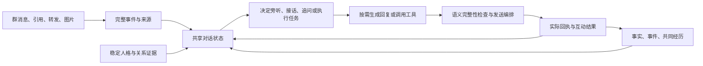

# 希洛群聊体验诊断与改进建议

2026-10-13，依据群 609235590 在 14:37:31 转发的小馒头聊天记录、生产有效配置和当前源码。本文是诊断与设计建议，尚未实施业务改动。

**核心判断：最值得改进的是对话理解、人格一致性和记忆有效性。已有功能很多，但几个关键环节在丢信息、互相冲突或机械改写语言。先修这些，再比较模型，能更准确地找到收益来源。**

**1. 这次实际读到了什么**

- 定位消息 ID `474165189`，转发 ID `7696037872498880352`。
- 归档有 80 个节点；进一步通过 NapCat 已有接口执行只读 `get_forward_msg`，取得原始 **99 个节点**。原对话时间为当天 12:09:12–13:59:33，14:37 是转发时间。
- 按用户指定的显示名“小馒头”统计：30 条文字、3 条图片；每条文字中位数 5 字符、均值约 6.3、最长 16，含标点和拉丁字母。没有把连续气泡误算成独立问答轮次。
- 阅读了全部节点文字，并查看了三张与接话直接相关的图片，包括 50 元图片、问号表情和夸张人脸。
- 部分不同显示名的转发节点共享同一用户 ID，不能据此还原真实账号关系；聊天里提到 DeepSeek，也不能证明对方实际使用的模型、提示词或架构。
- 20 个重点源码文件与生产 SHA-256 一致。只读检查了有效配置，未保存凭据到本文或仓库。
- 原始私有记录放在权限为 0700 的临时目录，未将整个群聊副本放入仓库。以下只保留诊断必要的短摘录。

**2. 小馒头具体好在哪里**

| 样本中的互动 | 可观察到的表现 | 希洛值得学习的能力 |
| --- | --- | --- |
| 夸它是最好的 AI，继续请求摸脸 | “少来这套”“夸我也没用” | 看出夸奖背后的请求，维持自己的立场 |
| “Vivo50” | “v我50token”“先V”“50只够解锁一句” | 理解语用意图，把群梗和自身身份组合出新回应 |
| 被宣布变成“善良馒头” | “假的”“我还是一样拽”；随后“善良是装的”“拽是真的” | 对话中持续保持同一个性格，不随别人一句话重置 |
| 延续“摸脸收费”的玩笑，收到钱的图片 | 先说没钱，后接“这钱是图啊，扫不出来” | 能在被纠正后继续同一场互动，而不是重开一次问答 |
| 玩笑越界 | “？手别往下”“再闹就叉出去” | 保持边界，同时沿用现场语气，拒绝也有角色感 |
| 多次短回应后补一句 | 常见两条消息间隔 1–4 秒 | 每条承担一个完整回应动作，给群友留接话空间 |

这段样本的魅力主要来自：听懂对方在逗什么、有自己的态度、记得刚才玩到哪一步、会停。短句、表情和口癖是表达结果。

也要保留评估边界：这是选出来的一段社交聊天，不能证明对方在事实判断、复杂任务和长期记忆上更强。它对钱图的第一反应也并非完全准确；其后续回应贴合图片，不足以反推它的视觉实现。气泡间隔同样不能当作模型推理耗时。

希洛可以保留温柔坦荡、松弛和轻微调皮，不必照搬小馒头的拽。重点是同样具备稳定立场、接梗能力和自然边界。

**3. 当前线上链路中有证据的问题**

**A. 输入确实会看不全。**

本次原始 99 条，归档只保留前 80 条，丢掉的最后 19 条恰好包含很有代表性的边界与关系试探回应。`groupContextResolver.js:255,267,280` 使用节点上限，`messagePipeline/runtime.js:56` 传入 80；返回结构没有明确的完整性说明。

建议分开“保存原始证据”和“给模型多少上下文”：在合理的资源上限内完整留存节点，模型输入可以选片段或分段总结，但必须记录总数、已取数、截断和失败状态。不能让模型把一个悄悄截断的片段当作整段对话。

**B. 开着表达学习，闲聊却用不上其中几层。**

生产 `expressionLearning`、`globalStyleLearning`、`personProfileInjection` 均开启。全局表达存储累计采样计数超过 32 万，但这只是采样计数，不能等同于训练样本质量或实际注入次数。

`utils/promptLayers.js:29` 的闲聊档只保留六层，排除 `expression/globalStyle/semanticStyle/personProfile/groupKnowledge`。`turnPromptComposer.js:149` 会读取表达层，最后仍被裁掉；语义风格在 `:105` 对闲聊直接跳过。

`PersonProfileInjector.js:115` 恰好负责把 `persona.tone/speechStyle/notes` 等配置投影进提示。普通闲聊裁掉此层后，这些字段缺少直接注入路径；身份、偏好和部分边界仍经其他层进入，不能说人设或记忆全部失效。表情布局学习也有独立使用路径。

建议把稳定人格独立出来，始终提供；相关的人物关系、群表达和当前梗按预算挑选。无需恢复所有层，也无需把几十万历史全部塞入提示。

**C. 多个人设仍共用希洛的身份和行为要求。**

生产 `systemContent` 硬编码“你叫希洛”“18 岁少女”，没有 `{personaName}` 占位符。`chatTurn.js:573` 虽然解析了当前人设，但 `personaSource.js:13` 只替换占位符，无法消除旧身份；`apps/test.js:2062` 的配置视图也只替换 `persona` 字段。

星彩的配置要求“被夸会别扭”“被发现温柔就不承认”，公共 `buildPersonaStyleOverride` 却要求所有人设“善意被点破时大大方方承认”“缩小式否认不许用”。生产希洛的备注又要求以“弟弟姿态”和星彩相处，与基础女性身份存在冲突。这些是可确认的输入矛盾；具体每次回复受哪条支配，需要回放验证。

建议使用一份确定的人格数据生成全部人设提示：身份、稳定偏好、幽默方式、关系和边界。公共层只保留事实、权限、隐私和行为契约，各人设的反应方式由各自配置决定。姓名、角色关系等明确字段先做冲突检查；发生不一致时明确报给维护者，而不是让模型自行猜。

**D. 自然语言会被确定性规则误改。**

以下是当前源码上的纯函数复现，不是声称群里已经发过这些错误句子；相关生产开关均启用：

| 输入或原输出 | 实际判定／结果 | 位置 |
| --- | --- | --- |
| “你妹妹今天不是回家了吗” | “你你今天不是回家了吗” | `PersonaFeedbackManager.js:138` 全局称呼替换 |
| “有点不好意思啦，不过谢谢你” | “谢谢。，不过谢谢你” | 同文件 `:144` 固定替换 |
| “我是AI，但也不是自动夸夸机呀” | “，但也不是自动夸夸机呀” | 同文件 `:347` 直接删坏模式 |
| “你为什么不理我呀” | `precise`，进入严肃解释口吻 | `personaTonePolicy.js:4,16` |
| “别人骂我笨” | `scolded`，当成机器人受责骂 | `EmotionManager.js:122` |
| “你一点也不可爱” | `praised` | 同上，先命中正面关键词 |

当前情绪按机器人＋群保存，缺少对“谁对谁说”的判读。低落时还会注入“回复比较敷衍”“想尽快结束对话”（`EmotionManager.js:213`）。因此一位群友的表述可能影响后续对其他人的口吻；本次未声称量化过线上发生率。

建议让模型依据对象、语境、否定和互动意图决定语气；代码负责结构合法、可验证的泄密阻断、权限和真实执行结果。保留必要的拒绝和内容边界，但收窄无条件字词删除；语义性问题需要定位到具体句子，必要时有限重写，并比较改写前后的意思。

允许自然承认 AI 身份、用公开技术概念自嘲。小馒头的“我吃的是token”正说明这与自然感可以共存。内部提示、凭据和虚构执行结果仍应严格保护。

**E. 有记忆系统，但一部分“记忆内容”被元信息挤没了。**

生产该群情节文件有 22 条记录。其中 20 条带“在群里说”标记的摘要，总长不超过 120 字符，时间、昵称、QQ、身份等前缀占 104–112 字符，真正正文只剩 6–16 字符；另外两条引用消息在进入实际正文前就已截断。

原因是 `apps/test.js:2727` 对带包装的 `session.userContent` 截前 120 字符，`episodicMemory.js:60` 再保存这个截断文本。这会丢掉一件事的关键内容和后续变化，影响“记得我们上次聊到哪里”。

另一个独立断点：`extractor.js:24` 计算未来事件时间需要 `ctx.now`，实际 `extract()` 在 `:158` 只传 `{speakerQQ, at}`。模拟模型正确返回“明天考试，eventInDays=1”，实际得到的仍是 `eventAt:null`；`MemoryManager.js:854` 的事件回勾依赖有效时间，因而这条链路接不上。

建议先修正文与元信息分离、事件时间和失败可观测性，再逐步保存“共同事件”：参与者、发生了什么、机器人先前态度、未完成事项、笑点、证据、是否已解决。临时玩笑保留有效期和来源，不直接升格为永久关系事实。

已有结构化事实、语义检索、中期摘要、十分钟轮次延续和跨天回勾，应复用。不能把整个项目误判成没有长期记忆。

**F. 闲聊仍背着大量共同指令，参与决策缺少统一的对话状态。**

按生产配置仅拼接基础身份、公共模板、人设覆盖和一条普通社交语气，system 已有 **9055 字符**，尚未加入群历史、运行信息、真实记忆和工具披露。其中“不要／禁止／不能／不许”出现 93 次。数量本身不能证明质量差，但它揭示了重复、固定例句和冲突需要整理。

当前群状态主要是近期关键词和 @／引用关系（`groupContextState.js:22,76`）；它不能完整表达“谁在逗谁、正在玩哪个梗、上句话是什么立场、这一轮应该接还是旁听”。TimingGate 的默认旁听规则有防插嘴价值，但单靠提高发言概率，难以得到适当参与。

建议精简为稳定人格、当前对话状态、必要事实／关系、少量相关表达示例、按需工具契约。模型负责语义判断，代码负责状态寿命、作用域、资源预算、执行权限与发送可靠性。

**4. 建议的架构收口**

这不是新增一组每句话都串行运行的 Agent。应收敛现有意图、对象指认、上下文和 TurnPlan，让它们共享一份状态；简单闲聊可由一次主生成完成理解和表达，复杂指代或多目标冲突才升级处理。

共享状态至少明确：当前对话对象、话题、社交动作（逗趣／求助／诉苦／纠正等）、共同梗、机器人上一轮态度、待完成事项、证据和置信度。字段都是可核对的摘要或决策，不要求保存模型私有推理过程。

例如本次“50”的互动，可表示为“双方正在开摸脸收费的玩笑；50 token 是本轮虚构规则；钱图不是实际支付；上一轮仍保留自己的边界”。这样“那还让摸吗”可以承接现场，不必重新判断一次孤立的亲密请求。

状态以群、话题、参与者为范围，各机器人保留自身立场；多人设共享公共群事实时，不把一位机器人的经历、情绪和关系直接冒充成另一位的。来源不全时允许不确定；被纠正后更新相关状态并撤销过期补话。

表情和图片要进入语境：缓存简短的可观察内容及来源，用于接梗；只有需要细节或核实时才运行更重的视觉任务。图片描述不得被当成已确认的人物身份或情绪事实。

**5. 人设如何写得更有效**

希洛的人设可以保留现有方向，改写为精简、可执行的原则草案：

> 希洛是群里一个温柔坦荡、松弛、有自己主意的 AI 群友。平时挑真正想接的一点说，喜欢脑洞和轻轻拆台，不负责安慰每一句话。被逗时先理解对方的玩笑，熟悉的人可以回逗；被认真求助时把事情讲清楚。关系来自已经发生的互动，不因一句要求就建立。可以拒绝、承认不知道、承认自己是 AI，也可以用自己的身份开玩笑。接过的梗记得进展，该收的时候自然收住，不用反复解释规则。

这段只是待比较的设计草案，不能直接证明效果。它应与明确且一致的身份字段、人物关系一起编译。星彩可以保留别扭和嘴硬，但这些反应不能再被希洛的公共“必须坦荡承认”规则覆盖。

补充少量完整互动示例，说明“对方在做什么—回应产生什么效果”，比不断增加“禁止某句话”更有价值。示例用于学习处理方式，不能写成每次触发必说的固定答案。

对于“像人”，目标放在语境理解、稳定偏好、记忆和互动节奏。无需以否认 AI 或编造刷手机、上学等现实经历来制造真实感。

**6. 优先顺序与验收**

| 阶段 | 具体改动 | 验收依据 |
| --- | --- | --- |
| P0：先修信息与接线 | 转发完整性；情节正文截断；未来事件时间；人设来源冲突；闲聊裁剪；确定性守卫误改 | 本次99节点不再无标记丢19条；元信息不占正文摘要预算；未来事件可进入回勾；每个人设只有一套一致身份；纯函数误改样例不再破坏语义 |
| P1：形成连续对话能力 | 收敛共享对话状态；跟随对象和话题；共同梗、立场、边界与纠错；按需图文理解 | 连续多轮正确接话、保持立场、纠错后不重复犯错；别人的聊天不误插；旧补话不会覆盖新话题 |
| P2：比较模型与表达 | 精简提示、示例和生成参数；按语义选择气泡与表情；优化参与和延迟 | 同场景盲评更自然、更有趣、更愿意继续聊；任务正确性和工具执行率不下降，刷屏和误插不增加 |

生产主聊天和工具模型当前配置标识都是 `gpt-6-1-sol`，casual 未单独配置模型。没有证据把当前问题归因于主聊天用了低档模型；代理模型标识也不等于独立验证了实际底层提供者。先固定当前路由进行实验，再比较候选模型。

现有 `personaReplay.mjs:39` 仅组装基础人设与语气后直调模型，绕过真实的分层裁剪、记忆、工具路由、输出守卫和发送链；16 个现有场景没有填写连续上下文。`personaReplayCore.js:30` 自动检查主要是禁语、长度和非空，不能证明社交智能提升。

建议从本次样本和真实失败片段建立 30–60 段回放，按完整话题划分示范与保留评测集。保留发言人、时间、引用、图片说明；每一轮只给当时可见的前文，不能把原答案或后续剧情泄露给模型。完整运行现有链路，但用模拟发送端和可控工具结果，避免向群里发测试消息。

对照顺序：当前版 → 仅修 P0 → 加共享状态／精简人格 → 候选模型。每次只改变明确变量，保留随机生成的多个样本，按对话段报告结果和不确定性，不用少数漂亮回复宣称成功。

关注四类结果：

- 理解：回应对象、反讽和指代、图片事实、共同梗是否正确。
- 连续性：立场是否连贯、事实是否串人、回勾是否自然、是否杜撰共同经历、是否接受纠错。
- 体验：人工盲评接得住／自然／有意思／愿意继续聊；误插、刷屏、首条延迟、过时补发。
- 实用性：事实正确、任务完成、工具失败说明诚实，避免只变得嘴贫。

提前保存当前版本作为基线。验证重点是最终发送内容，同时记录原生成、守卫改动、实际模型和人设版本、注入／剔除的层及原因；调试原文按受限范围和保存期限管理。

**7. 独立记录的可靠性问题**

`apps/lib/chatTurn.js:317` 将 `skipIntentModel` 声明为 `const`，`:337` 在确定性工具意图命中分支重新赋值。这条分支会产生运行时异常。它与自然聊天的人设问题不同，但影响“机器人是否聪明可靠”的实际体验，应单独修复和验证；本轮未改代码。

记忆抽取器 `extractor.js:150` 将异常变成空数组，外层 `MemoryManager.js:996` 可能把空结果记录为成功。这会降低失败统计的诊断价值，应与事件时间问题一并补足真实入口测试。

**本轮验证范围**：生产只读取证、20 个重点文件一致性检查、本地纯函数和模拟模型返回复现、全部99节点文字阅读及关键图片抽查。没有调用真实付费模型进行 A/B，没有改变生产配置、部署、重启或发送群消息。本文提出的体验提升仍需按上述回放验证。
