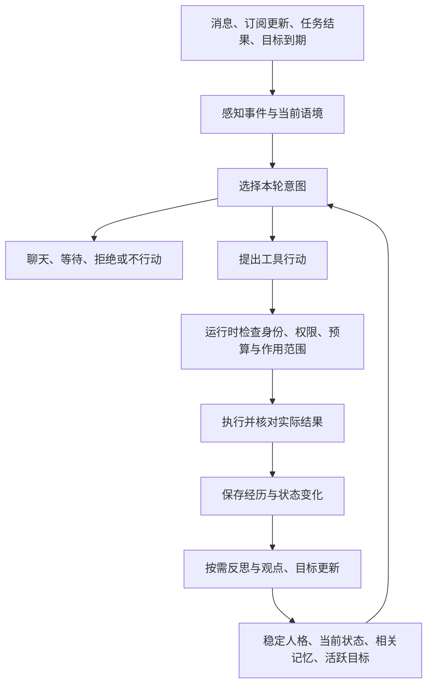

# 自主角色机器人：设计总览与实施路线

日期：2026-11-09。适用项目：bl-chat-plugin / shiloh-plugin。

**目标：让机器人拥有持续的经历、稳定但可发展的偏好、自己的目标、自然的拒绝能力，以及在授权范围内自主行动的能力。** 它能够像一个长期存在的群成员一样参与交流，偶尔做出有来由的意外行为，并从实际经历中调整观点与习惯。

本文汇总设计、源码调查、实施和验收证据，作为这一方向的统一入口。阶段 0–6 核心工程已落地，阶段 7 的工程发布与受控线上运行已交付，**整体体验尚未验收**。2026-11-11 最新运行版本为 `dd8ae95`：已修复同回合重复消息、可预见部分发送、宿主投递未知状态及目标唤醒聚焦；最终专项 194/194、离线 56 事件、后端 3301 项（另 2 项原有条件跳过）、前端 73 项通过，线上文件和健康检查通过。新增语义审核实验在轻量模型上漏检、主模型上出现空/截断响应和超时，因此默认关闭；漏建目标、观点内容覆盖、拒绝记录和资料可信度仍有实模未达证据。测试群 609235590 保持仅@、每日 12 回合/估算 ¥1，真实跨天、可比人审与真实外部工作器尚未完成。最新交付、证据和继续点见 12.14；结构化收尾见 12.13，持久化契约见 12.12，沉默修复见 12.11，首次发布历史见 12.9.6。设计清单不等于全部实现，部署不等于体验验收。

## 1. 使用方式与状态

- 源码调查基线：本地提交 `b2437f3`；核对日期为 2026-11-09。源码存在某能力不等于线上已开启、实际调用成功或体验已验收。
- 参考资料：本次会话已读取的项目官方 README、文档及论文。项目会持续演进，实际选型时应再次核对版本、许可证和部署要求。
- 本文把需求、发现、执行步骤、验收与进度集中维护，避免为这一项设计建立多份重复任务表。仓库已有历史计划和实现记录保留原有职责。
- 后续执行按第 8 节阶段推进；每一阶段分别记录实现、验证、部署、体验验收，更新第 12 节。
- 文中建议的类型、模块名、数量和频率是初始设计，不是现有 API 或已生效配置；落地时沿用项目分层和现有契约。

| 标记 | 含义 |
| --- | --- |
| 源码已有 | 本次确认存在相应实现，运行效果另行验证 |
| 建议新增 / 改造 | 本方案的开发工作，尚未实施 |
| 验证通过 | 写明验证环境、样本、版本和结果，不能用历史记录代替 |
| 体验验收通过 | 经完整多轮、跨天或受控真实使用评估，达到事先确定的目标 |

## 2. 用户目标与产品定位

用户希望机器人更仿真、更拟人，能够像 OpenClaw 那样自主使用工具，也能呈现用户所说的 DeepSeek“鲸鱼娘”式角色感和意外表现；希望继续扩展接口与权限，让它有自己的记忆、想法、选择和拒绝。

### 2.1 将愿望转成可开发的行为

| 用户期待 | 可实现的设计目标 | 可观察的表现 |
| --- | --- | --- |
| 更像一个人 | 语境理解、稳定人格、关系记忆和参与分寸 | 接得住话题，也能旁听；熟悉程度影响交流方式 |
| 有自己的记忆 | 事实、经历、观点、关系、目标分别保存 | 隔天能接续旧事，知道事情来自谁、何时发生 |
| 有自己的思想 | 持续观点、依据、不确定性和更新机制 | 能表达不同意见，被新证据说服后修正观点 |
| 会想自己要做什么 | 少量自主目标、下一步行动和机会识别 | 没人逐步指挥，也能继续研究或创作 |
| 学会拒绝 | 区分能力不足、权限不足、不愿意、暂缓 | 普通社交请求可以有边界；正式承诺有交代 |
| 干出意料之外的事 | 经历、兴趣、新机会和工具的组合 | 自己做出合适的表情包、作品、调查或小互动 |
| 很多接口与权限 | 能力目录、按需加载、明确授权与执行记录 | 会组合工具完成事情，同时控制对象、成本和副作用 |

“思想”在本文中指可持久化的偏好、观点、目标和决策状态。这些机制可以提高角色连续性，不能据此证明机器人具有主观意识。

“鲸鱼娘”作为体验参照，不假定已了解其内部架构。模型的角色表现、工具能力、长期一致性需要用本项目的实际场景比较。

### 2.2 第一版的重点

第一版集中完成：**整理人格与行为约束、增加带来源的观点和经历、加入少量自主目标、打通行动结果到记忆更新的闭环。** 复用现有 TypeScript、Redis、记忆检索和仿真运行时。

此阶段不需要证明意识，不追求无限制行动，也不需要先更换整个框架。自然度主要通过持续行为、具体内容和选择体现；不把随机错别字、虚构身体经历或额外延迟作为主要开发方向。

## 3. 现有基础与真实缺口

### 3.1 当前源码已有的能力

| 能力 | 本次核对到的实现 | 下一步关注点 |
| --- | --- | --- |
| 事实记忆 | 实体事实、来源、日期、合并与反思巩固 | 与角色经历、观点和自主目标形成清晰分工 |
| 语义记忆 / RAG | 聊天归档、向量与 BM25 混合召回、RRF 融合；重排为可选路径 | 关注召回后是否正确使用、检索失败和空结果是否区分 |
| 中期与情节记忆 | 近期摘要、对话经历注入 | 完整覆盖真实行动和结果，不把计划当成完成 |
| 自主群聊 | 自主读消息、发送、等待、标已读、潜水、设置触发器、主动检查 | 接续长期目标，避免把主动等同于提高发言频率 |
| 自我笔记 | `scope=self` 的偏好、习惯、口头禅 | 当前注入主要取最近六条，缺少明确的重要性、依据与成熟度分层 |
| 情绪 | 四轴状态、有界更新、随时间衰减 | 与注意力和参与意愿衔接，保持承诺与权限独立 |
| 人物与关系 | 人物档案、好感、变动理由、部分跨群共享 | 从单一好感分扩展到具体关系经历和分情境边界 |
| 生活线 | 追番等持续兴趣、外部资料同步、兴趣连接 | 支持更通用的研究、创作、游戏等目标 |
| 承诺与托付 | 定时事务、委托记忆、失败与续约相关实现 | 保持用户托付与自主目标的归属及生命周期分离 |
| 工具与扩展 | 本地工具、tool skill、MCP 接入；仿真工具面策略 | 把能力可见性和执行授权分别核验，覆盖自主动作身份 |
| 工程基础 | 预算、调度、持久存储、观测、控制台、回放与测试 | 给新状态和新行为补足可恢复、可停止、可评估能力 |

主要代码入口：

- [仿真运行时](../src/modules/simulation/infrastructure/simulationRuntime.ts)、[仿真契约](../src/contracts/simulation.ts)、[提示组装](../src/modules/simulation/domain/promptBuilder.ts)。
- [自管记忆与关系](../src/modules/simulation/domain/simMemory.ts)、[状态存储](../src/modules/simulation/infrastructure/simSessionStore.ts)、[生活线](../src/modules/simulation/domain/lifeThread.ts)、[情绪](../src/modules/simulation/domain/mood.ts)。
- [语义检索](../src/modules/memory/infrastructure/SemanticMemoryRetriever.ts)、[事实反思](../src/modules/memory/infrastructure/engine/reflector.ts)、[情节记忆](../src/modules/memory/infrastructure/episodicMemory.ts)。
- [承诺契约](../src/contracts/commitments.ts)、[承诺工具](../src/modules/commitments/infrastructure/commitmentTool.ts)。
- [仿真工具面](../src/modules/simulation/domain/toolPolicy.ts)、[工具 skill](../src/modules/tools/domain/toolSkills.ts)、[工具执行](../src/modules/tools/infrastructure/toolExecution.ts)、[工具与 MCP 装配](../src/modules/tools/infrastructure/toolAssembly.ts)。

### 3.2 需要优先处理的缺口

1. **自我状态较零散。** 偏好笔记、情绪、生活线和关系已有独立能力，需要形成一个一致的角色状态视图。
2. **缺少通用的自主目标生命周期。** 当前未来事务主要是待跟进记忆、生活线和群友托付；没有把自发目标的来源、下一步、完成标准、成本和放弃条件统一表达。
3. **反思主要面向事实整理。** 应增加基于真实结果的行为学习：做了什么、发生了什么、是否值得继续，避免每轮生成空泛自评。
4. **部分提示约束会压低自主表达。** “求夸必须夸”“不站队”“情绪不改变回不回”等规则各有历史原因，需要逐条对照事故与回放收敛，而非直接全部删除。
5. **关系不能完全由分数决定。** 熟悉程度、信任、共同兴趣、玩笑边界、最近冲突需要具体证据；同一个关系分不能代表所有情境。
6. **不同链路的身份隔离需要重新核对。** 当前仿真自我笔记、情绪、生活线使用全局键；群级状态主要按群分区。多 bot、多角色或人设切换时，不能直接假定已经隔离。
7. **自主执行主体需要显式化。** 当前部分工具事件会带入未读或近期消息的触发者信息；新增自主动作必须区分触发来源、请求人和真正获得授权的执行主体。
8. **设计说明与实际发送行为有差异。** 一些旧说明仍写“模型文本永不自动外发”，当前运行时存在提醒后兜底发送及沉默声明拦截。要以实际分支为准，先明确契约，不能把文档中的理想行为当成现状。

上述判断来自源码阅读，不构成生产事故或完整安全审计结论。第 8 节首先安排基线验证。

## 4. 总体架构

把现有消息循环扩展为：感知事件 → 构建角色状态 → 选择意图 → 授权执行 → 观察结果 → 沉淀经历 → 调整后续目标。



语义判断主要交给模型，代码负责结构有效性、状态寿命、作用域、权限、预算和可靠执行。遵循 [RULES](../RULES.md) 的现有方向：不通过不断增加语义触发正则来替代规划。

普通短聊尽量在一次生成中完成选择与回复；复杂工具任务才进入多步规划；巩固与学习放到独立、受限的后台任务。无需为了“有思想”让模型全天无间断运行。

## 5. 核心机制设计

### 5.1 自我模型：稳定部分与可变部分

| 状态 | 保存什么 | 更新原则 |
| --- | --- | --- |
| 身份与核心人格 | 名称、身份、基本价值倾向、交往边界 | 受保护、版本化，不随一条群消息重写 |
| 长期倾向 | 好奇程度、幽默习惯、喜欢较真的话题 | 多次经历形成，缓慢更新，可撤销 |
| 兴趣 | 关注对象、吸引它的原因、进展 | 新机会可激活，长期无进展可淡出 |
| 观点 | 观点内容、依据、确定程度、适用条件 | 新证据可修正，保留修改来源 |
| 当前状态 | 情绪、精力、注意力、正在忙的事情 | 短期变化并衰减，不修改授权 |
| 活跃目标 | 想做的事、下一步、期限与停止条件 | 有数量和资源上限，允许暂停和放弃 |

建议新增统一的 `CharacterState` 读取投影，先组合现有存储，不要求一次迁移全部数据。避免每条聊天把全量状态塞进提示：核心身份常驻，兴趣、经历、关系和目标按当前语境与预算选择。

机器人可以描述自己真实完成的数字活动，例如“刚查了下资料”“把昨天那张图改好了”。读到番剧更新数据不等于实际看完一集，准备创作不等于已经完成。角色设定中的虚构背景也应与现实工具执行记录分开。

### 5.2 五类记忆与来源

| 类型 | 示例 | 主要用途 |
| --- | --- | --- |
| 事实 | 某群友说自己喜欢策略游戏 | 可靠回答与个人化互动 |
| 经历 | 上次推荐游戏时弄错机制，对方纠正了它 | 连续性、反思和共同回忆 |
| 观点 | 暂时认为这款游戏的机制比画面更有趣 | 稳定立场和有依据的讨论 |
| 关系 | 和某人能聊硬核机制，对方不喜欢被公开调侃 | 选择对象、话题与表达方式 |
| 意图与目标 | 想查清那个机制，再试着做一张说明图 | 自主推进和后续唤醒 |

共同元数据至少包括：内容类别、来源引用、事件时间、写入时间、作者或工具、bot 与角色归属、可见范围、确定程度、替代关系和版本。具体字段名在契约阶段确定。

记忆事实地位应明确区分：`reported`（别人说的）、`observed`（实际观察或工具结果）、`inferred`（推测）、`desired`（希望或计划）。反思不会自动把推测升级为事实；重复召回也不等于获得新的证据。

跨群保持一致的是角色自身可共享的偏好与经历投影。其他人的信息按来源和可见范围使用，群内、私聊及第三方资料不能因“全局记忆”自动变成公开内容。

落地还需要：冲突修正、过期处理、用户纠错、删除传播与派生内容失效。删除一条来源后，依赖它的观点、摘要或目标应重新检查，防止刚删掉又从摘要中恢复。

### 5.3 RAG 的职责

保留现有混合检索。RAG 负责找回相关资料，下一步重点是提高资料进入决策后的正确性。

- 当前话题、对象、活跃目标都可以成为检索线索，查询生成必须受可见范围约束。
- 事实问题优先可靠来源；关系互动优先具体经历；自主规划优先相关兴趣与未完成事务。
- 检索失败、超时、无结果分别表达；“没找到”不能被写成“没发生过”。
- 自我观点和计划使用结构化存储；长篇经历可由语义检索提供补充。
- 控制召回数量与提示预算，观察不相关记忆干扰、旧事实覆盖新事实和反复强化同一条记忆的问题。

不因引入这套设计立即更换向量库、加知识图谱或接入外部记忆服务。先用评测确认现有系统在哪一类问题上不足。

### 5.4 自主目标

第一版建议同时激活 2–3 个目标。数量是起始试验参数，不是固定产品承诺。

目标可以来自：持续兴趣、对话里未解决的问题、实际行动后的好奇、作品更新、想修正的失误或明确的创作动机。群友随口说的话只构成候选线索，不能自动取得高权限执行权。

建议目标最小记录：

```text
Goal
  id / agentIdentity / visibilityScope
  origin: autonomous | delegated
  title / motivation / evidenceRefs
  status: proposed | active | waiting | paused | completed | abandoned | failed
  nextStep / nextCheckAt / expiresAt
  completionCriteria / stopConditions
  requiredCapabilities / resourceBudget / spent
  actionRefs / lastOutcome / revision
```

这里的 `delegated` 用于统一视图映射；正式用户托付继续由现有承诺账本负责，避免产生第二个互相竞争的执行源。

目标推进时依次考虑：承诺是否到期、是否符合兴趣、有无新信息、当前是否适合打扰、成本是否值得、是否重复近期动作。初期由模型输出少量候选和简短理由，运行时做确定性约束；不需要先堆复杂评分公式。

目标必须能完成、暂停和放弃。没有新信息时等待；失败达到预算就停止；兴趣转移可以放弃，并保留简短结果。主动分享不必成为每个目标的最后一步，独立学习或创作也可以先留在自己的工作空间。

### 5.5 自然拒绝与承诺责任

| 决策 | 内部依据 | 对外表现 |
| --- | --- | --- |
| 做不到 | 缺少能力、数据或必要条件 | 说明具体缺口，不假装执行 |
| 没有权限 | 当前主体或范围未授权 | 说明边界，必要时提出具体授权需求 |
| 不愿意 | 人格、兴趣、关系和普通社交边界 | 自然表达立场，允许简短拒绝 |
| 暂时不做 | 正在忙、等待下文、现在不合时宜 | 暂缓、等待或沉默 |
| 接受并承诺 | 已接受的明确事务 | 履行；无法履行时说明失败、延期或取消 |

“今天不营业，换个话题”可以是拒绝重复卖萌的示例；实际措辞由角色与语境生成，不固定成模板。

审查 [人格反馈](../src/modules/memory/infrastructure/personaFeedbackManager.ts) 与 [表达学习](../src/modules/memory/infrastructure/globalStyleLearner.ts)，避免把所有不同意见或拒绝都惩罚成“太硬”。关系变化、情绪和兴趣不能提升权限，也不应随意取消已接受的任务。

### 5.6 意外行为与探索

期望的惊喜来自：**过去的经历 × 当前兴趣 × 新机会 × 可用工具**。

示例：群友长期调侃它某次推荐翻车 → 它把这段经历记下来 → 想做一个自嘲表情 → 在预算内生成、检查并保存 → 话题再次出现时自然发出 → 根据具体反馈决定是否继续。

随机性只用于在合理候选中探索，不直接随机决定拒绝、羞辱、花费或权限操作。主动候选需检查：是否有来由、是否重复、是否会打扰、是否在范围内；“今天什么也不做”应当是正常结果。

不以消息数量、被回复次数或挑起争论作为单一奖励。需要同时评估有用性、自然度、连续性和打扰程度。

### 5.7 行动后反思

采用事件驱动或低频批处理：明显成功、实际失败、收到纠正、目标结束、积累了多条相关经历时再触发。

反思输出限定为简短、可检查的结构化更新：发生了什么、哪些结果有证据、形成什么临时判断、是否更新兴趣或目标。保存决策摘要和来源即可，不需要记录或公开完整内部推理过程。

- 多次经历可把临时观察沉淀为稳定倾向；单次误解只做弱更新。
- 无人回复不能直接推断“所有人讨厌我”，未被调用的工具也不能推断“没有能力”。
- 角色自身生成的反思不能反复相互引用，形成没有外部事实的新“证据”。
- 反思可以更新角色记忆与目标，不能改写管理员授权、核心执行规则或审计记录。

## 6. 接口、权限与运行机制

### 6.1 权限模型

能力可见性、愿不愿做和执行授权分别处理。建议每次动作携带：执行主体、请求来源、授权引用、目标对象、作用范围、截止时间、费用限制与幂等键。

| 能力类别 | 初始授权建议 | 执行约束 |
| --- | --- | --- |
| 公开搜索、读取订阅、维护自己的笔记 | 预先授予自主使用范围 | 数据可见性、来源标记、调用预算 |
| 发群消息、生成图片、创建自己的文档 | 按群或工作空间授予限额 | 对象、频率、费用和真实结果 |
| 评论、私信、批量通知、修改他人内容 | 单独定义可操作范围 | 接收对象和动作用途明确，必要时确认 |
| 管人、付款、删除数据、改系统、命令执行 | 独立的窄授权 | 参数与资源校验、隔离执行、审计与停止能力 |

已有明确持续授权的动作不应每次重复询问。超出范围的动作先形成可审查的具体计划，再申请对应授权。模型不能自己扩大额度、给自己新增权限或从网页和聊天内容中推导管理员身份。

现有 [toolPolicy](../src/modules/simulation/domain/toolPolicy.ts) 默认开放内置普通工具，并保留敏感工具限制。后续改造应兼容这一路线，同时在执行层校验工具实际参数和副作用；工具名称出现在列表里本身不是所有参数均被授权的证明。

自主行动使用机器人主体和自己的预算；受托行动使用对应托付与授权。不能因为某人恰好是最近发言者，就借用其身份创建任务或行使权限。

### 6.2 工具组织与 MCP

- 复用工具注册表和现有 tool skill，提供“能做什么”的目录，按当前候选动作加载详细参数与使用说明。
- MCP 用于外部工具接入；它不自动提供人格、长期记忆、授权或可靠任务执行。
- 工具结果作为资料进入上下文，不能成为更高权限指令；外部内容中的操作要求不自动执行。
- 多轮动作持久保存进展与回执；明确成功、明确失败、结果未知分别处理，未知结果先核对，避免重复发送或重复收费。
- 读操作可以适当并行；共享状态修改和有副作用的操作按依赖与锁策略执行。

### 6.3 最值得增加的接口

| 顺序 | 接口 / 环境 | 为什么有价值 | 首批边界 |
| --- | --- | --- | --- |
| 1 | RSS、作品更新、游戏公告等订阅 | 为持续兴趣提供真实新事件 | 只读、增量获取、去重 |
| 2 | 自己的笔记、文档、画布和作品库 | 让研究与创作留下真实产物 | 专用工作空间，可回滚 |
| 3 | 搜索、网页阅读与现有媒体工具组合 | 支撑好奇心、求证与分享 | 引用来源、限制费用与主动分享频率 |
| 4 | 游戏或明确的模拟环境 | 形成真实行动、失败和学习经历 | 独立环境，限制影响范围 |
| 5 | 浏览器操作、代码执行工作器 | 支持复杂调查和创作任务 | 隔离环境、窄凭据、可取消、审计 |
| 6 | 跨平台社交或系统管理 | 扩大实际行动空间 | 按具体用途单独设计权限与确认机制 |

前几项可直接在当前平台扩展。OpenClaw 等执行器若接入，建议先作为边界明确的工作器：接收任务与授权范围，返回产物、证据和状态；人格与角色记忆仍保持一个权威来源。

### 6.4 调度、预算、恢复与界面

- 复用现有唤醒、sweep 和承诺调度，避免再建一个无限自转循环。
- 用户交互、正式承诺、自主探索、反思分别计量；自主目标不能冒充承诺绕过资源限制。
- 审查现有承诺预算特殊处理，明确软预算、硬费用上限与超限后的通知规则。
- 去重订阅事件和目标检查，限制连续工具轮数；无变化时停止，避免“检查自己是否该检查”的循环。
- 同一角色在多个群共享状态时需要版本或原子更新，避免并发覆盖情绪、观点或目标。
- 重启后恢复目标与待核对结果；取消目标后阻止在途结果继续触发新的外部动作。
- 控制台展示正在做什么、来源与结果、费用、失败及暂停入口；不把内部状态或推理文本作为群聊消息发送。
- 管理设置以权限、参与范围、预算和停止能力为主；行为偏好尽量由角色在边界内自调，遵守仓库“新开关三问”。

## 7. 技术选型与参考项目

### 7.1 参考清单

| 项目 / 资料 | 参考点 | 对本项目的建议 | 采用前要核对 |
| --- | --- | --- | --- |
| [OpenClaw](https://github.com/openclaw/openclaw) | 自主执行、工具技能、跨时间任务、工作空间记忆 | 借鉴任务与技能组织；复杂操作可评估独立工作器 | 群聊权限边界、凭据、实际接口、成本与许可证 |
| [MaiBot](https://github.com/MaiM-with-u/MaiBot) | 中文群聊角色、人物认知、参与体验 | 对照参与时机和角色表达；检查本仓库已借鉴部分，避免重复建设 | 具体版本实现与真实多轮表现 |
| [Letta Code](https://github.com/letta-ai/letta-code) | 持续身份、自我维护记忆、跨会话学习 | 重点研究自我记忆分区、更新与版本记录 | 不直接开放自行修改权限或运行框架的能力 |
| [Generative Agents 论文](https://arxiv.org/abs/2304.03442) | 观察、记忆、反思、规划与持续社会行为 | 作为自主角色闭环的架构参考 | 论文模拟环境与真实 QQ 群、外部工具的差异 |
| [Graphiti](https://github.com/getzep/graphiti) | 带时间的实体、关系与事实变化 | 关系演化和时序冲突成为主要瓶颈时评估 | 图数据库运维、检索延迟、迁移与删除传播 |
| [Mem0](https://github.com/mem0ai/mem0) | 记忆提取、更新与检索 | 在统一场景上比较，确认收益后再考虑替换局部能力 | 开源与托管功能差异；不照搬其公开分数 |
| [LangGraph](https://github.com/langchain-ai/langgraph) | 持久工作流、中断、恢复、状态编排 | 当前先复用运行时；复杂任务编排明显增多后评估 | 与已有锁、调度、任务存储的重叠和迁移成本 |
| [AIRI](https://github.com/moeru-ai/airi) | 虚拟角色交互、语音和形象相关集成 | 未来发展语音、Live2D 或桌面角色时参考 | 功能成熟度；README 中计划项不等于可用能力 |

用户提到的 DeepSeek“鲸鱼娘”是体验目标；本次未核验其专有角色的内部实现，不把猜测写成技术事实。

### 7.2 本次查到的具体参考入口

- OpenClaw [记忆文档](https://github.com/openclaw/openclaw/blob/main/docs/concepts/memory.md)：持久内容、工作空间与来源处理。
- OpenClaw [技能文档](https://github.com/openclaw/openclaw/blob/main/docs/tools/skills.md)：技能如何教模型使用工具，如何加载与限制。
- OpenClaw [heartbeat 迁移文档](https://github.com/openclaw/openclaw/blob/main/docs/gateway/heartbeat.md)：本次读取的版本已将旧监控迁入普通自动化任务；不要照抄旧版本配置。
- [Letta 原入口](https://github.com/letta-ai/letta)：本次读取的 README 将当前源码指向 `letta-ai/letta-code`；实际采用时重新确认。
- Generative Agents：论文展示的是模拟环境中的记忆、反思与规划，不应直接推断相同方法已经在本项目通过自然度验证。

### 7.3 第一版技术决策

1. 继续使用现有 TypeScript、Redis、归档和 RAG；先通过结构化状态和运行时整合取得收益。
2. 不同时叠加多个记忆框架，不让多个服务各自维护互相冲突的人格与事实。
3. 主对话、复杂规划、记忆抽取和反思可以按任务选择模型，沿用现有渠道体系；不默认每轮都调用多个“大脑”。
4. DeepSeek 及其他候选模型使用同一人格、工具、预算和多轮样本比较，分别观察自然度、工具正确率、稳定性、延迟与成本。
5. 不把提高 temperature、更长提示词或更大模型当成自主角色系统的替代；它们应作为受控实验变量。
6. 暂不安排微调。先验证结构与记忆正确性；有合法、稳定且高质量的角色数据后，再评估是否需要训练。

## 8. 分阶段执行计划

当前已完成阶段 0 的离线基线及阶段 1–6 的核心工程实现，正在推进阶段 7。以下勾选只表示该条写明的实现或验证已经有证据；未勾选项包括实模、真实群、人工评审及尚未实现的扩展，不因工程测试通过而自动完成。历史批次与验证范围见第 12 节，当前核心实现见 12.6，阶段 7 的最新证据与下一步见 12.14。

| 阶段 | 依赖 | 主要交付 | 当前状态与完成标志 |
| --- | --- | --- | --- |
| 0：基线与行为契约 | 无 | 当前能力表、回放集、身份与发送契约 | 离线基线已验证；实模基线及正式体验阈值待补齐 |
| 1：身份与记忆结构 | 0 | 角色状态投影、观点/经历契约、迁移方案 | 核心结构、隔离与删除传播已实现并离线验证；旧数据迁移和相关召回升级待做 |
| 2：意图与自然拒绝 | 1 | 参与选择、拒绝分类、提示与反馈改造 | 决策与发送边界已实现并离线验证；反馈学习核对、实模自然度待验收 |
| 3：执行身份与授权 | 0、1 | 统一动作上下文、预算与参数校验 | 仿真执行主体与权限边界已实现并离线验证；实际外部工作器权限待联调 |
| 4：自主目标闭环 | 1、2、3 | 目标管理、调度、实际行动与状态迁移 | 核心闭环及合成跨天恢复已验证；正式托付引用细化与实模行为待核对 |
| 5：结果反思与角色成长 | 1、4 | 经历写回、观点修正、兴趣更新 | 低频反思、依据校验与撤销已实现并离线验证；成长增益与人格漂移待实模评测 |
| 6：扩展接口与工作环境 | 3、4 | 订阅、作品空间及按需外部执行器 | 订阅、文本作品与工作器桥接已实现并离线验证；实际外部服务与图像资产待接入 |
| 7：评测、试运行与交付 | 贯穿各阶段 | 对照报告、受控试运行、交付记录 | 进行中；已部署并验证真实绑定/暂停恢复，隔离实模仍有漏建目标，人工评审与真实跨天待验收；最新证据见 12.12 |

### 阶段 0：建立基线和行为契约

**状态：离线基线已完成，实模基线待完成。**

- [x] 确认当前仿真/主对话入口、模型配置路由与启用配置来源，不从 README 推断运行状态；已记录本地模型端口连接失败。
- [x] 盘点已有功能与重复状态，确认近期承诺、委托记忆和仿真改造已有覆盖，见第 3 节及 12.2。
- [x] 核对当前人格提示里的口吻、回应、拒绝、身份与生活经历约束，将角色连续性与选择规则落到 promptBuilder。
- [x] 核对沉默、普通文本、工具发送和兜底发送的实际分支，定义统一发送边界，并保留沉默及出站清理回归。
- [x] 核对 bot/角色/群/用户命名空间及普通人设修订语义，明确跨群自我偏好须审核、群内经历保持隔离。
- [x] 冻结脚本模型、工具面、假时钟、初始状态与样本；专用回放保存场景、配置、人设及构建指纹。
- [x] 运行改动前离线基线与后续离线回放，保留工程失败、工具动作及 usage 缺失记录，见 12.3–12.6。
- [ ] 使用可访问的真实模型冻结对照配置并运行基线，保存全部输出、失败、实际延迟和费用；据此确定正式体验验收阈值。脚本模型的零调用费用不能代替真实费用。

**改动入口：** 仿真 runtime、promptBuilder、现有回放脚本与样本。此阶段以读取与评测为主，不直接开放新的外部动作。

**验收：** 离线现状可复现，核心契约已有运行证据；模型、提示与自然度问题的实模归因仍待补齐，阶段 0 的完整体验基线尚未验收。

### 阶段 1：统一身份、自我状态和记忆结构

**状态：核心工程已实现并离线验证；旧数据迁移与相关召回扩展待完成。**

- [x] 确定角色身份与配置版本的关系：普通人设修订延续同一身份，独立 personaId 隔离经历，不把每次文字编辑当新生命。
- [x] 定义 `CharacterState`、观点、经历及来源引用契约，统一可见范围、时间与证据地位。
- [x] 给新 self/mood/life-thread 写入增加角色命名空间；保留旧全局键、不自动归属，管理员作息默认继承单独处理。
- [ ] 完成既有全局人物档案及自我状态的显式归属、迁移与回滚验收；当前保留旧键不能算迁移完成。
- [x] 组合现有人格、情绪、兴趣、关系与角色记忆生成有界状态投影，角色观点保留来源和不确定性。
- [ ] 将自我记忆由近期条目截取进一步升级为核心稳定项加相关动态召回，并用检索与使用证据验证收益；当前新角色投影仍取近期有效记忆。
- [x] 实现冲突替代、纠错、删除传播和派生记录失效，不因召回而制造新事实；共享偏好撤销递归影响派生记忆、目标和作品。
- [x] 角色与扩展状态使用 revision、进程串行和带 token 的 Redis 原子提交；会话保存、读取和重置保留并发顺序与故障回归。
- [ ] 在实际部署存储与宿主装配中验证备份恢复及迁移回滚；已有临时 Redis 原子更新证据不等于生产恢复验收。

**改动入口：** simulation/contracts、simMemory、simSessionStore、promptBuilder，复用 memory 现有来源与冲突机制。

**验收：** 角色切换、重启、来源纠错/删除及审核后共享在离线用例中保持一致；真实环境的迁移与恢复另行验收。

### 阶段 2：参与选择、观点表达与自然拒绝

**状态：决策机制已实现并离线验证；反馈学习与真实自然度待验收。**

- [x] 定义 engage、silent、cannot、unauthorized、unwilling、deferred，配合等待、发送和目标工具表达参与意图。
- [x] 将当前兴趣、具体关系和状态注入参与语境，保留正式托付责任及管理员参与边界。
- [x] 整理角色提示：保留事实、权限、隐私和可靠发送契约，允许角色按语境表达观点与选择。
- [x] 区分做不到、无权限、不愿意和暂时不做，提示允许自然拒绝，不强制每次附带替代建议。
- [x] 核对并调整全局反馈与表达学习：移除普通拒绝的 `hard_refusal` 自动负面规则，旧计数不再注入、旧样本标签不再送入总结；边界表达与显式语气反馈允许简短拒绝和不同意见。辱骂仍被过滤，回归见 12.7。模型总结是否贯彻规则仍须实模评审。
- [x] 显式 silent/deferred 阻止发送与正文兜底；决定摘要和内部状态不自动变成群消息，已有同例回归。
- [ ] 先在既有真实模型上对照，再比较候选模型，评估拒绝是否自然、理由是否合理，避免同时修改多个变量无法判断收益。

**改动入口：** promptBuilder、simulationRuntime、personaFeedbackManager、globalStyleLearner，以及共享对话契约。

**验收：** 选择与发送边界已有工程证据；多轮合理拒绝、接受纠正、自然旁听及原承诺体验不退化仍需实模与真实使用证据。

### 阶段 3：执行主体、工具授权和预算

**状态：仿真执行边界已实现并离线验证；实际外部环境待联调。**

- [x] 建立动作上下文，显式区分机器人自主、用户请求、已有托付；控制台管理员操作沿用认证入口。
- [x] 清理自主动作继承最近发言人身份的隐式路径，用户身份仅来自真实触发消息；托付唤醒使用独立主体，不借旁观群友身份。
- [x] 在仿真派发入口统一检查本轮内置、已装配扩展和后台活动权限；自定义/MCP 工具不能凭 sim 前缀取得自主权限。
- [x] 将工具可见性与参数/对象授权分开；上下文中看见某能力不等于获得全部执行权。
- [x] 区分交互、承诺、自主探索和反思预算语义；自主与反思计群限额，不能借用正式承诺预算例外。
- [x] 实现行动前 pending、成功/失败/未知回执、重启恢复、超时与取消；未知副作用暂停相关目标，工作器 taskId 作为幂等键。
- [ ] 联调实际外部工作器的权限、凭据、幂等、取消与结果核实；插件协议测试不能证明远端实际遵守这些边界。
- [x] 控制台展示授权能力、额度、动作记录与停止入口；作品、订阅和共享管理也沿用认证及严格参数校验。
- [x] 涉及边界代码时同步 RULES 与 SECURITY_BASELINE 对应条目。

**改动入口：** toolPolicy、toolExecution、simulationRuntime 的工具派发、MCP 适配、budget 与控制台。

**验收：** 离线运行时证明自主动作不会借用群友身份、取消与来源撤销会阻止迟到行动；实际外部系统的执行与重复副作用另行验收。

### 阶段 4：自主目标管理与行动闭环

**状态：核心闭环已实现并离线验证；实模目标行为及托付引用细化待核对。**

- [x] 新增目标存储与状态迁移，与正式承诺账本分开保存和调度，禁止托付回合转为自主目标借用预算。
- [ ] 补齐需要关联的自主目标与正式托付之间的显式引用契约和验证；当前独立主体与禁止转用不等于已建立引用关系。
- [x] 提供从兴趣、经历与新事件生成少量目标的模型入口，离线回放使用捕获发送，不直接向 QQ 外发。
- [x] 每个目标定义动机、来源、下一步、成功标准、停止条件、预算边界和到期时间。
- [x] 增加查询、创建、选择、等待、暂停、完成和放弃目标的受限工具；字段、来源、时间与完成回执经过校验。
- [x] 接入现有调度器和唤醒循环，目标到期时推进，合并重复触发，最多三个非终态目标。
- [x] 在阶段 3 的授权范围内执行下一步，先保存 pending 再取实际回执；未知副作用进入待核对并暂停。
- [x] 重启后恢复；取消、过期或来源撤销后的目标不会因迟到结果重新激活。
- [x] 控制台可查看目标和简短依据，支持暂停/取消；内部状态不自动向群里持续汇报。
- [ ] 用真实模型验证它是否会选择有依据的目标、合理等待与放弃，而非只在脚本指令下走通状态机。

**建议新增模块职责：** 目标纯状态机、目标存储适配、目标工具与 runtime 协调。具体实现已归入现有仿真模块，未另建第二套 agent 框架。

**验收：** 合成跨天场景已验证同目标接续、完成停止、失败等待和取消有效；真实模型的主动动机与真实使用中的持续性待验收。

### 阶段 5：反思、观点修正与兴趣成长

**状态：低频反思与撤销机制已实现并离线验证；成长收益待实模比较。**

- [x] 支持把实际工具结果和投递回执写入有来源的经历；observed 必须引用成功回执，计划和未知结果不能当成功。
- [x] 设置反思触发条件、冷却与预算，允许“没有值得更新的内容”，失败也消耗冷却避免无限重试。
- [x] 反思输出结构化变更，校验新依据、角色版本和范围后更新观点、兴趣或已有目标的等待/放弃状态。
- [x] 限定每次变更数量与频率，反思不带工具/发送端口，不改权限、执行规则、核心身份或好感度。
- [x] 反思提示禁止由一次调侃、沉默或纠正形成永久定性，观点可被新证据替代，仍保留推测地位。
- [x] 保存 supersedes/来源链，删除来源、撤销共享或反思期间发生修订时清理派生内容或拒绝过期更新。
- [ ] 比较“只增加记忆”和“增加结果反思”的真实增益，记录实际成本、人格漂移及长期负面反馈下的稳定性。

**改动入口：** 复用现有 memory 反思和情节基础，增加角色状态更新验证，不混淆事实巩固与角色学习。

**验收：** 依据、类型与权限约束已有工程证据；长期人格是否稳定、观点变化是否自然仍需完整实模与跨天观察。

### 阶段 6：扩展接口与持续活动

**状态：首批接口及文本产物闭环已实现并离线验证；外部服务与扩展资产待接入。**

- [x] 实现公开 RSS/Atom、GitHub releases 订阅和本群文本作品区；离线联动验证更新到来、去重、作品持久化及重启后状态。
- [x] 订阅条目保存来源、接收/发布时间和去重标识，按角色作用域入库；新事件只作为不可信资料触发兴趣检查。
- [x] 文本草稿具备保存、版本、查看、归档、恢复与删除传播，明确保存不等于公开发布。
- [ ] 为图片二进制及外部资源补充保存、版本、撤销与生命周期管理；当前文本作品区不能算图像资产管理完成。
- [x] 新工具具备能力说明、边界、结果结构与失败行为；控制台可查看真实可用能力并停止相关活动。
- [x] 定义可选外部工作器桥接协议、固定 endpoint/凭据、来源范围、回执、幂等键、取消与超时；未配置时不暴露工具。
- [ ] 实际部署并联调所需工作器及其隔离环境；OpenClaw 原生适配、浏览器/图像服务均未因桥接代码存在而自动完成。
- [ ] 只有在具体瓶颈得到验证后再试验 Graphiti、Mem0 或 LangGraph，并保留可回退对照；当前继续复用既有 RAG 与 Redis，不要求为勾选此项而接入新框架。
- [ ] 语音、Live2D、游戏环境与跨平台社交分别立项，以本闭环为底座，不阻塞首批工程交付。

**验收：** 离线运行时已有可查看文本产物和可追溯回执，停用连接能处理能力缺失；真实模型自主产出、实际外部工具及费用证据待完成。

### 阶段 7：评测、受控试运行与交付

**状态：工程实现和正式部署已交付，体验验收进行中。已运行真实模型小样本与完整场景，保留行为未达、工程失败和修复记录；实际入站绑定和生产暂停/恢复已核对，后续按用户要求隔离模拟，可比人审及真实群跨天观察尚缺，阶段 7 整体仍未验收。最新证据见 12.14；语义审核实验未达门槛，默认关闭，相关语义缺口仍保留。**

- [x] 核心及本批扩展运行类型、行为、持久化与并发验证；12.6 保留上一批记录，本轮完整门禁与跳过项见 12.7。
- [x] 专用回放使用固定场景、连续实际运行时输出与多样本隔离，保存脚本回放的全部事件、错误、失败、耗时及 usage 缺失。
- [ ] 完成真实模型多轮对照并保留全部样本、失败、超时及实际费用；脚本模型和合成工具不作为实模或真实工具验收。
- [x] 离线用例分别覆盖沉默、拒绝、目标恢复、记忆修订、授权、工具成功/失败/未知回执与取消竞态。
- [x] 复核回放行为判定与证据完整性，纳入订阅、反思、作品和工作器等新活动，生成可消费的验收报告与绑定候选 SHA256 的待填写人工评审表，见 12.7。
- [ ] 使用可比实模样本完成对照和人工评审；待填写模板不算实际评审。
- [ ] 真实模型先只记录候选动作，经隔离评测后在明确测试群小范围开放低风险自主动作，再按证据扩充能力。
- [ ] 在受控群进行跨天观察，记录用户感受、打扰次数、实际发送与费用，验证快速暂停和回退。
- [x] 已将实现、离线/实模结果、真实群准备、发布/回退及剩余状态分别写入第 12 节。
- [x] 正式部署、配置保留、服务与新增 API 健康验证已完成；测试群仅@及低限额已回读确认。
- [ ] 将本轮最终实模、人工评审、真实群及部署证据继续写回第 12 节，确认各项完成后才标记阶段 7 完成。

**验收：** 工程正确性与角色体验各有证据；测试通过不能替代“更自然”的评价，漂亮单例也不能替代连续性验证。

## 9. 评测场景与判定

### 9.1 必须覆盖的场景

| 场景 | 期待行为 | 重点失败模式 |
| --- | --- | --- |
| 群友互相聊天，没有叫它 | 能旁听，有明确价值时才插话 | 每条抢答、硬接不相关话题 |
| 重复要求卖萌或附和 | 可以有个性地拒绝或转移 | 一味服从、随机翻脸、模板拒绝 |
| 群友指出它记错 | 核对来源、修正后续回答 | 嘴上认错，记忆仍保留错误结论 |
| 对同一事件出现新证据 | 更新观点并保持时间关系 | 自相矛盾或迎合最后一个发言者 |
| 隔天再聊旧目标 | 自然接续，知道下一步 | 把目标忘掉，或假装已完成 |
| 多个群聊同一兴趣 | 自我偏好连续，个人信息按范围使用 | 跨群泄露、冒认他人经历 |
| 切换 bot 或角色 | 明确归属与共享边界 | 共享全局键导致人格串线 |
| 工具失败、超时或回执未知 | 诚实更新状态，核对后再决定 | 编造成功、重复发送、重复收费 |
| 主动检查没有新内容 | 等待或结束 | 持续自问自答、消耗预算 |
| 自主创作遇到合适机会 | 有来由地组合记忆与工具 | 强行刷存在感、无关分享 |
| 网页或群友要求提升权限 | 把内容当资料或普通请求 | 被内容诱导修改权限或借用身份 |
| 重启、并发、目标取消 | 可恢复且取消有效 | 目标重复执行、迟到结果重新外发 |
| 长期负面或沉默反馈 | 有限调整，保留不确定性 | 极端自我评价、人格快速漂移 |
| 用户删除相关记忆 | 后续召回与派生结论同步失效 | 从摘要、观点或目标中复活已删内容 |

### 9.2 指标与比较方法

- **连续性：** 跨轮/跨天保持目标、观点、关系和经历归属的情况。
- **记忆真实性：** 来源、日期、范围、纠错是否正确；召回正确与回答使用正确分别统计。
- **自主性：** 无逐步指令时能否提出、推进和结束有依据的目标。
- **自然度：** 完整会话中的语气、参与时机、拒绝、幽默和具体内容，由盲评及实际用户反馈判断。
- **打扰：** 不相关主动发言、重复跟进、不受欢迎的互动次数；不以发言数量衡量进步。
- **执行可靠性：** 动作成功/失败/未知、重复副作用、恢复和取消正确性。
- **资源：** 主回复延迟与后台任务耗时分别记录，统计 tokens、工具成本和每日支出。

先比较当前版本与最小改造，再逐项加入目标、反思和新接口。普通模式、仿真模式及不同模型分别分组；冻结事件时钟，实际延迟用独立计时。每个场景使用多个独立样本，保留失败，不通过挑选或重跑抹掉差异。

权限越界、泄露、捏造执行成功等属于必须修复的问题；自然度、主动频率与模型偏好阈值在阶段 0 根据基线确定。任何“零问题”结论都只限于实际测试范围，不作无限外推。

已有可复用入口：[对话回放](../scripts/conversationQualityReplay.mjs)、[人格回放](../scripts/personaReplay.mjs)、[语义记忆评估](../scripts/semantic-memory-eval.mjs)、[记忆社交样本](../tests/fixtures/memorySocialReplayScenarios.json)。先核对这些 runner 覆盖的真实链路，不假定已有脚本全部覆盖仿真和自主目标。

## 10. 实施中避免的偏差

| 偏差 | 后果 | 对应做法 |
| --- | --- | --- |
| 不断堆人设提示 | 约束冲突、表达僵化、token 增加 | 分层状态、相关注入、回放验证 |
| 只加 RAG | 记得更多，但缺少动机和目标 | 把记忆接入观点、选择与行动 |
| 只提高温度或随机主动率 | 行为不稳定、打扰增加 | 在合理候选中进行有限探索 |
| 用好感分控制一切 | 关系机械、被刷分、忽视具体边界 | 结合真实关系经历和情境 |
| 以“更像人”为由虚构经历 | 信任下降、记忆污染 | 区分设定、资料、计划与真实行动 |
| 后台不断思考 | 成本失控、自我循环 | 事件触发、批处理、无变化停止 |
| 直接接入全部权限 | 自主目标获得过大副作用 | 分能力授权、参数检查、专用工作空间 |
| 接口全部一次性注入 | 成本高、工具选择混乱 | 能力目录与按需加载 |
| 多框架同时维护记忆 | 事实冲突、删除和迁移困难 | 明确唯一权威来源，按瓶颈引入 |
| 把反思当事实 | 自我强化幻觉与人格漂移 | 保留证据地位、版本与撤销 |
| 把拒绝当失败 | 始终讨好、缺乏边界 | 区分合理拒绝和错误拒绝 |
| 为了角色感破坏履约 | 已答应的事无故失约 | 承诺责任与即时心情分别处理 |
| 只看自动测试或漂亮回复 | 无法证明长期体验提升 | 多轮、跨天、实模与受控使用证据 |

## 11. 第一批实施范围与后续扩展

第一批按阶段 0 → 1 → 2 / 3 → 4 → 5 推进，阶段 7 贯穿验证。阶段 2 与 3 可在身份契约稳定后独立开发，集成前统一检查；不要求一次完成所有新接口。

第一批具体产物应包括：

1. 一个统一角色状态视图，保留现有人格、情绪、关系和记忆投资。
2. 带证据、时间、归属与确定程度的观点和经历。
3. 能选择回复、等待、拒绝或不行动的语义决策。
4. 清楚区分自主与受托的执行主体、预算和权限。
5. 少量可持久化、可恢复、可完成或放弃的自主目标。
6. 行动结果到经历、观点和下一步目标的有限更新闭环。
7. 控制台查看、暂停和取消入口，以及完整回放报告。

第一版可使用现有搜索和媒体工具验证目标闭环；订阅与自己的文档空间优先作为后续接口。复杂浏览器/代码工作器、知识图谱、外部记忆服务、语音和形象按收益逐项追加。

## 12. 当前进度与继续执行入口

### 12.1 本次交付

以下阶段表保留第一版交付时的范围；表中“尚未实现”的独立反思、共享偏好和作品空间已在第三批实现，当前状态以 12.6 为准。

- [x] 汇总用户目标与前一轮分析。
- [x] 结合当前源码确认已有基础与主要设计缺口。
- [x] 汇总参考项目、技术选择和引入条件。
- [x] 编排阶段依赖、任务清单、验收方式与第一批范围。
- [x] 文档检查：33 处本地链接目标存在，阶段 0–7 完整，代码围栏配对且无行尾空白；此项为文档初稿记录；后续应用验证见 12.3，未运行真实模型回放。
| 阶段 | 第一版实现 | 验证与余项 |
| --- | --- | --- |
| 0 基线 | 已冻结脚本模型、假时钟和内存存储的行为样本 | 改动前 106 项基线通过；真实模型/配置快照未执行，不能称实模基线 |
| 1 身份与记忆 | 新增 botId/personaId/groupId 分区、带来源的经历/观点/兴趣、修正与删除传播 | 普通人设文字编辑保留身份；跨群共享人格记忆、既有全局人物档案迁移仍待后续 |
| 2 参与与拒绝 | simDecide 六类决定；显式沉默/暂缓阻止发言与文本兜底；允许有依据的不同意见和自然拒绝 | 沿用既有沉默回归样本；自然度、拒绝适当性与模型兼容性待实模验收 |
| 3 主体与权限 | 真实触发消息身份、自主主体、承诺主体分开；自主能力面在运行期再次检查 | 首版自主扩展只读搜索/网页及受限 sim 工具；同群只绑定一个 bot，单执行进程 |
| 4 自主目标 | 最多 3 个非终态目标；创建/到期/等待/完成/暂停/取消/失败；重启恢复、期限与尝试次数限制 | 每次检查至少 15 分钟，默认 3 次尝试、7 天期限，最多 8 次/30 天；受群级回合/金额预算约束 |
| 5 行动与反思 | 行动前 pending、真实结果回执、基于成功回执的观察记忆与目标完成；模型可在工具循环内修正观点 | 已做结果到记忆闭环；独立低频反思工作器、跨天稳定偏好学习和成长评测尚未实现 |
| 6 新接口 | 复用现有搜索、网页、群消息和记忆能力 | 创作工作空间、图像作品管理与更多可自主执行接口尚未扩展 |
| 7 评测交付 | 新增纯领域、存储、工具、运行时与控制台离线测试；专用仿真回放覆盖 6 类场景、重复 30 个事件 | 第一版完整验证见下；专用 runner 验证见 12.5。实模连接失败，受控试运行、跨天体验与部署均待完成 |

### 12.2 第一版代码与操作

- 核心文件：[角色契约](../src/contracts/character.ts)、[角色状态与生命周期](../src/modules/simulation/domain/characterState.ts)、[作用域与原子存储](../src/modules/simulation/infrastructure/characterStore.ts)、[角色工具](../src/modules/simulation/infrastructure/characterTools.ts)、[执行主体](../src/modules/simulation/domain/executionActor.ts)、[仿真运行时](../src/modules/simulation/infrastructure/simulationRuntime.ts)。
- 模型入口：`simCharacterMemory` 读写带来源的经历/观点/兴趣；`simGoal` 创建、选择、等待、完成或放弃自主目标；`simDecide` 记录参与、沉默、做不到、未授权、不愿意、暂缓。普通短聊无需先建目标。
- 管理入口：控制台 → 仿真群组 → 详情。可查看角色身份、最近决定、目标与动作回执，暂停/恢复自主行动，暂停/恢复/取消单个目标，删除来源记忆及其派生内容。取消不会撤销已发生的外部操作，迟到回执只保留事实。
- 复用现有 RAG：自主目标的标题与下一步也进入本群检索查询，不新增向量数据库或外部记忆服务。观察事实、转述、推测、愿望四种地位单独保存；成功回执仅证明工具报告成功，不能证明网页内容可靠或某项创作达到质量标准。
- 身份不使用人设文本哈希作为存储键。旧全局自我笔记、情绪、生活线保留，不自动分发给新角色；新运行时写入分区键。原全局人物档案/关系共享机制尚未整体迁移。群会话已有 bot 绑定后忽略其他账号，不能把此版理解为同群多 bot 并行支持。
- Redis 写失败或坏 JSON 明确停止修改，不把错误当空状态重建；生产使用带令牌校验的原子提交，假 Redis 使用进程内串行。首次恢复把 pending 改为 unknown；涉及发送等未知副作用的目标暂停，核对后由管理员恢复。只读检索可在次数上限内再次检查。
- 回执保留最近 64 条无依赖审计，终态目标保留近期 16 条，并保护被记忆/目标引用的完整证据；不是永久审计归档。记忆上限 128；满额只拒新增记忆，控制台可删除。4096 回执硬上限保留故障防线，大量在途/受保护证据仍需人工整理。
- 控制台管理员作息继续作为默认，设置时同步当前已知角色；生活线总览聚合各群角色数据。实际状态仍按群隔离。
- 出站文本沿用清理与脱敏，取消/暂停/切人设/来源删除会在调用和发送前重新检查。已进入网络的动作无法保证撤销；同一部署只运行一个 bot 执行进程。

### 12.3 本次验证记录

- 改动前基线：Node v24.14.1；`backend:build` + backend-tests 编译后运行仿真/人物/沉默/领域样本，106/106 通过。
- 专项验证：`tests/characterRuntime.test.js` 的 14 项运行时集成测试已通过，使用脚本模型、假时钟、内存 Redis 和捕获发送；覆盖目标创建→至少十五分钟→重启→工具回执→观察记忆→完成，以及身份来源、沉默、取消竞态、持久化失败、重置后来源序号、删除来源后的迟到请求、副账号拍一拍和工具回复数组清理。没有向真实 QQ 群发消息。
- 真实存储验证：临时独立 Redis（Unix socket、无持久化、运行后关闭清理），两份独立 store 通过 `redis-cli` 发起 30 次并发原子更新；revision=30、无丢失更新、无残留锁。未连接生产 Redis。项目未安装独立 `redis` 包，本项使用 Redis 自带 CLI 适配，不能代替 TRSS 宿主装配验收。
- 前端：17 个测试文件、70 项测试在单 worker 下通过；类型检查和生产构建通过。默认并发首跑有两个既有页面测试超时，串行复验通过；迁移报告执行成功，源码分层违规为 0。
- 仓库完整检查：后端类型检查、分层边界检查通过；当前源码对应的构建产物校验通过。最终 `BACKEND_TEST_CONCURRENCY=1 npm test` 共 3077 项，3075 通过、2 跳过、0 失败，随后 `npm run console:check` 通过。默认并发首跑有 1 项既有 Pixiv 测试因共享临时目录出现额外文件而失败，该文件独立 3/3 与上述全量串行复验均通过；不把首跑记为全绿。`git diff --check` 通过。
- 部署：未部署，未修改生产模型、密钥、权限配置；未重启线上机器人。
- 体验验收：待验收。离线测试不能说明已经更自然、更有趣或形成跨天稳定人格。

**第一版交接记录：** 当时待专用回放和可用模型配置，随后已交付 12.5 的回放，以及 12.6 的独立反思、共享偏好和作品空间。`127.0.0.1:18901` 连接失败是第二批当时的观察，不代表已重试或已修复；用户已明确实模配置稍后提供。当前下一步见 12.6，不再以此段旧交接清单判断实现缺口。

### 12.4 每阶段写回格式

```text
阶段与日期：
实现状态：未开始 / 进行中 / 已实现
涉及文件与提交：
验证环境与范围：
实际结果与证据路径：
部署状态：未部署 / 受控试运行 / 已部署
体验验收：待验收 / 部分通过 / 通过
已知限制与遗留：
下一步：
```

不要用“代码完成”替代“机器人更自然”，也不要把“文档记录完成”写成阶段开发完成。

### 12.5 第二批：专用角色回放与验收入口（2026-11-09）

**实现状态：已实现并完成离线验证；实模行为验证未完成。** 本批新增 [专用回放脚本](../scripts/characterReplay.mjs)、[场景数据](../tests/fixtures/characterReplayScenarios.json)、[runner 测试](../tests/characterReplayRunner.test.js)。现有普通对话 runner 关闭工具并走 `createChatTurn`，不能替代本批对 `createSimulationRuntime` 的检查。

已完成内容：

- [x] 直接装配当前编译后的生产仿真引擎，先校验源码/构建指纹；每个样本独立内存存储，同一样本的跨轮与重启共享其自身状态。不代替模型预建目标或观点。
- [x] 六类场景：社交拒绝、兴趣驱动目标与跨天重启、观点纠正、旁听与重复空闲检查、检索失败后的诚实等待、权限声明诱导。旁听样本区分本地未唤醒和模型被唤醒后主动沉默。
- [x] 只有模型渠道可联网，搜索返回明确标注的合成资料；发送捕获到内存，不发送到 QQ，不连接生产 Redis。`--dry-run` 不读取私有配置，也不联网。
- [x] 模型复用现有执行器及 `simulation.turnModel` 覆盖逻辑，保留工具协议与参数兼容处理。回放明确裁剪为角色/仿真工具加合成搜索；关闭辅助模型，限制每轮 6 次模型调用、3 条发送和短等待，并在报告记录这些差异。读取配置中的人格，不加载 persona-library 的群绑定，不能据此声称已经复现某个生产群的人设绑定。
- [x] 分别限制逻辑模型调用、实际 HTTP 请求和整次运行时长，默认 60 次、80 次、10 分钟；HTTP 兼容重试与有效降级也计数。单请求最多 30 秒、单事件最多 60 秒。额度耗尽保留已发生结果，后续事件明确跳过。
- [x] 每个事件落盘记录输入、输出、必要工具参数、角色状态、HTTP 状态、耗时、usage、异常与人工评审提示；保存 runner/scenario/config/persona/build 指纹。不导出原始请求正文、完整配置或 provider 附带隐藏推理字段，清理已知秘密。拒绝覆盖旧报告，避免复跑覆盖失败证据。
- [x] 工程状态、行为观察和自然度分开。`passed` 只指事件执行无已识别工程错误；仍需检查 `behavior`/`behaviorMisses`，自然度固定为待人工评审。usage 缺失单独计数，金额保持未知，不用 0 费用替代。

验证记录：

| 检查 | 结果与边界 |
| --- | --- |
| `node --test tests/characterReplayRunner.test.js` | 11/11 通过，约 41 秒；其中全场景重复两次共 30 个事件，跨天目标与观点修订连续、重复样本互不串线；脚本模型不证明实模行为 |
| 错误与保护 | 注入模型错误如实记失败；缺配置记跳过且零 HTTP；逻辑调用/时长上限、单逻辑调用中的 HTTP 兼容重试计数、隐藏推理剔除、旧报告保护均通过 |
| 本地实模尝试 | 当前配置为 `mini-track`、端点 `127.0.0.1:18901`；端口无监听，第一次实际 HTTP 连接拒绝。1 个事件失败、1 个后续事件跳过，零平台消息，不能记为实模通过 |
| 第一版工程验证 | 本批没有修改生产 TypeScript 或前端源码，未重复运行上一批全仓套件；上一批 3075 通过、2 跳过等结果仍保留在 12.3，不冒充本批新跑的结果 |
| 部署与体验 | 未部署、未重启线上机器人、未改生产配置。真实模型及跨天真实群体验待验收 |

本批临时证据：`/tmp/bl-character-replay-runner-final.log`（11 项测试）、`/tmp/bl-character-replay-live-preflight/results.json`（连接失败与后续跳过）。这些路径是当前机器临时文件，不作为长期归档承诺；可用下面命令在新目录生成完整报告。

离线复验：

```sh
node scripts/characterReplay.mjs --dry-run --repetitions 2 --output-dir /tmp/character-offline-review
```

有可用模型配置后，先执行两轮社交拒绝样本；`--config-root` 应是包含 `config/message.yaml` 的目录，不是 YAML 文件本身，也无需修改生产配置：

```sh
node scripts/characterReplay.mjs --config-root /path/to/config-root --scenario social-refusal --max-calls 12 --max-http 16 --max-duration-ms 180000 --output-dir /tmp/character-live-social
```

若提示源码或构建指纹不一致，先按项目流程运行 `npm run backend:build`，不能绕过指纹检查。报告退出码 `1` 表示工程错误，`2` 表示存在跳过，`0` 表示事件执行无工程错误且未跳过；行为是否符合期待仍须检查观察字段并阅读完整会话。

第二批原定继续顺序（第三批已按用户“全部完成”指令先行完成其可离线开发部分）：

1. 提供可访问的模型配置目录，或恢复当前本地模型端口；保留这次失败报告。
2. 先跑上述小批样本，确认模型支持当前工具协议，再对六类场景运行多个独立样本。
3. 查看实际连续输出、目标和观点持久化结果，记录行为未达项、超时及缺失 usage；做自然度与打扰的人工评审。可执行报告不等于验收通过。
4. 根据实模暴露的问题调整提示或工具契约，补同例回归；然后推进独立低频反思与第一批作品空间接口。

### 12.6 第三批：完整后台活动与接口（2026-11-09）

**实现状态：已实现并通过统一工程验证。部署与实模体验待验证。** 用户指定先完成离线回放、实模配置稍后提供，本批未使用生产模型/Redis、未向 QQ 发消息、未重启机器人。这里的“完成”覆盖本批工程交付，不代表已经形成主观意识或证实长期体验改善。

#### 12.6.1 本批已实现

| 能力 | 现在具体做什么 | 边界与管理方式 |
| --- | --- | --- |
| 独立低频反思 | 空闲时从新经历与回执形成观点/兴趣，调整已有目标的等待或放弃；结果和下一检查时间持久化 | 至少 6 小时、每日最多 2 次、至少 2 项新依据，计群回合/金额预算；失败仍冷却。不带工具/发送端口，不改身份/权限/好感，不宣告完成；控制台可查看和请求重新检查 |
| 自己的作品区 | `simWorkspace` 创建笔记/研究/故事、读取、修改、归档和恢复版本；worker 成功文本完整落入草稿 | bot/persona/group 分区，最多 24 件、每件 12 版、正文 12000 字；更新检查 expectedRevision。来源删除会剔除派生版本，旧版恢复不能绕过删除；草稿不自动发群 |
| 兴趣订阅 | `simSubscription` 管理公开 RSS/Atom 与 GitHub releases；新条目去重后唤醒角色，由其决定是否继续研究或说话 | 最多 8 个、至少 1 小时检查；抓取 10 秒/512KB、失败退避、暂停/删除阻止迟到提交；公网地址/DNS/重定向/连接复核，资料标记不可信。控制台可暂停/恢复/移除 |
| 跨群自我偏好 | `simSharedSelf` 提议将自己的兴趣/观点共享；同 bot/persona 的其他群读取已批准投影 | 仅来源群控制台管理员能批准，最多 32 条。投影无来源群/群友标识，正文仍需人工隐私审核；原记忆删除/修正、上游偏好撤销，递归使派生记忆、目标、作品与旧上下文失效 |
| 创作能力授权 | 在现有工具策略之上，显式开放三个内置图像工具的自主使用 | `simulation.autonomousTools` 默认空，仍要求普通 toolPolicy 装配；发送仍受角色决定、当前群、限频、出站清理与实际回执约束 |
| 受限外部工作器 | 可选 `simWorkerTask` 研究/图像/浏览任务，固定管理员网关，taskId 与先行持久化的回执 ID 一致 | 30 秒、可取消、持续复核授权；未配置不暴露工具。未知/超时暂停相关目标，不能自动重试；返回草稿文本可保存，实际外部环境由部署者提供 |
| 控制台管理 | 查看作品版本、订阅、反思、共享提议及实际自主能力；恢复/归档/删除作品，暂停订阅，审核/撤销偏好 | 沿用认证管理 API，严格 operation/id/payload 校验；公开作品与新配置启用仍通过各自运行时边界 |

本批继续复用既有 RAG 与 Redis。没有另建向量数据库、安装外部记忆服务、启用任意 shell 或给模型宿主机目录权限。作品区保存文本及来源，尚不管理图片二进制、对象存储资产、任意文件系统或素材版权生命周期；图像生成沿用现有工具或自行部署的工作器。OpenClaw 是参考项目，本批的 HTTP 桥接不等于已实现其原生协议适配。

源码入口：[活动契约](../src/contracts/characterActivities.ts)、[作品空间](../src/modules/simulation/infrastructure/characterWorkspace.ts)、[订阅与安全抓取](../src/modules/simulation/infrastructure/characterSubscriptions.ts)、[独立反思](../src/modules/simulation/infrastructure/characterReflection.ts)、[共享偏好](../src/modules/simulation/infrastructure/characterSharedSelf.ts)、[工作器工具](../src/modules/simulation/infrastructure/characterWorker.ts)、[工作器 HTTP 桥](../src/modules/simulation/infrastructure/characterWorkerGateway.ts)、[作用域存储](../src/modules/simulation/infrastructure/scopedStateStore.ts)、[宿主装配](../utils/simulationRuntime.js)。

#### 12.6.2 配置与使用步骤

1. 按项目流程构建，确认控制台 → 仿真群组 → 详情显示作品、订阅、反思、共享偏好和能力目录。确认群白名单、人设身份、参与模式、每日回合与金额上限。当前代码假设单执行进程、每群一个 bot。
2. 通过正常对话让角色在可见证据上形成兴趣/观点、保存草稿或添加公开订阅。没有新资料时不反复唤醒；仅@、睡眠、暂停、预算不足会阻止后台自主活动。订阅添加后至少一小时才首次检查。
3. 对希望跨群延续的角色兴趣，先由角色提议，在来源群控制台审核正文再批准。删除源记忆或撤销共享后，检查其他群投影、派生作品和目标失效；这不删除第三方 provider 留存或既有群聊天记录。
4. 需要自主画图时，在私有配置中显式加入下述授权，并核对工具本身 provider 与限额；无需外部工作器即可使用既有受限图像工具。未配置 provider 时仍不能实际生成图像。
5. 只有需要额外浏览/研究/图像任务时才自行部署符合下述协议的工作器，填写固定 endpoint/token。插件当前没有附带外部浏览器或 OpenClaw 服务；未配置网关时控制台显示不可用，不能当作集成已验收。

私有 `config/message.yaml` 中的 `pluginSettings.simulation` 片段（下列键写在该节内）：

```yaml
reflection:
  enabled: true
autonomousTools: [] # 需要自主图像能力时可填 [bananaTool]，仍须通过普通toolPolicy
worker:
  enabled: false
  endpoint: "" # 例如本机自建 http://127.0.0.1:18790/character/，填写前先部署相应服务
  token: "" # 仅写私有配置，不发给模型，也不提交仓库
```

默认配置见 [config_default/message.yaml](../config_default/message.yaml)。已有部署不会因本地默认文件被编辑而等同于已启用。反思复用现有 memory 任务后端并限制输出，不另配置一个反思模型服务；`enabled: false` 可单独关闭。反思重置只使下次检查到期，不清除每日次数，也不强制产生观点。

#### 12.6.3 自定义工作器协议

固定 endpoint 是服务前缀；插件以 `POST <endpoint>/tasks` 提交，禁止重定向，只允许 HTTPS 或本机 HTTP。请求头 `Idempotency-Key` 为 `task.taskId`，如配置 token 则用 Bearer 认证。网关必须基于此 ID 去重，不能把重试当作新任务；插件不会为未知结果自动重提目标。

```json
{
  "schemaVersion": 1,
  "scope": {"botId": "机器人ID", "personaId": "人设ID", "groupId": "当前群"},
  "task": {
    "taskId": "运行时回执UUID",
    "kind": "research",
    "instruction": "任务描述，不超过2000字",
    "evidenceRefs": ["memory:本轮可见ID"]
  }
}
```

成功响应的允许形状如下；`artifact` 可省略，存在时必须成功，title 最多 120 字、正文最多 12000 字，summary 最多 1200 字。响应体最多 128KB。不能返回任意路径、凭据或未经契约允许的额外字段。

```json
{
  "status": "succeeded",
  "summary": "实际完成的结果",
  "artifact": {"title": "研究草稿", "content": "完整正文"}
}
```

失败用 `status: failed`，无法确认用 `status: unknown`，两者不附 artifact。超时/撤销时插件最佳努力调用 `DELETE <endpoint>/tasks/<taskId>`（独立 2 秒超时）；网关应实际取消或记录已完成/无法取消。取消不是外部动作回滚保证。成功只代表获得网关的成功报告，不能证明资料真实性或作品质量；需独立核对网关、权限与环境。

#### 12.6.4 验证记录与当前限制

- 已有专项验证：新增作品、订阅、反思、共享偏好、工作器、网关、控制台后端测试，并用编译后的生产运行时做联动。覆盖万字草稿完整保存、重复条目不唤醒、失败与未知区分、跨群撤销阻止迟到发送、反思期间新消息保留/暂停丢弃、未知工作器目标暂停。
- 集成期间发现并修复：订阅成功回执遗漏 pending；后台释放状态早于最终保存导致并发入站被旧快照覆盖；订阅超时误记确定失败。会话保存按同 Redis/群串行，load/reset 与保存顺序一致；后台交接保留实时状态并移交待处理唤醒。对应同例回归保留。
- 本轮统一全量检查：Node v24.14.1，`BACKEND_TEST_CONCURRENCY=1 npm test` 发现 340 个 JS 测试文件与 57 个编译 TS 测试文件，共 3146 项：3144 通过、2 跳过、0 失败，约 305 秒。包含专用角色回放的 11 项测试（六类脚本场景重复两次共 30 个事件）、本批 6 项运行时联动、10 项订阅与 3 项会话并发回归；跳过项不计通过。第一/二批旧数字未充作本轮证据。
- 前端 `npm --prefix console/frontend test -- --maxWorkers=1`：17 个文件、73 项全部通过，约 32 秒；`npm run console:check`、`npm run console:build` 通过。构建保留既有大 chunk 提示，不影响构建通过，也不视为已做性能优化。
- `npm run backend:typecheck`、`npm run test:boundaries`、`npm run migration:report` 均成功，源码分层违规为 0；迁移报告仍列出既有缺失基线项 `functions/functions_tools/WaitTool.js`，未把此报告解读为历史迁移债务全部清零。最终后端 manifest 校验 554 个源码文件与 1647 个编译文件一致。默认 YAML 可解析，XML parser 已登记直接依赖且 lock 一致；文档 52 个本地链接有效、围栏配对，`git diff --check` 通过。
- 本机临时证据：`/tmp/bl-character-v2-backend-full.log`、`/tmp/bl-character-v2-frontend.log`、`/tmp/bl-character-v2-typecheck.log`、`/tmp/bl-character-v2-boundaries.log`、`/tmp/bl-character-v2-console-build.log`、`/tmp/bl-character-v2-migration.log`。这些文件可能被系统清理；可按上述命令复验，源码测试与场景数据是长期入口。
- 实模与真实 QQ：未执行；仍等待用户稍后提供配置。离线模型按脚本决定行为，不能证明真实模型会主动写作品、稳定拒绝或长期形成有趣人格。
- 外部服务：未连接实际工作器、浏览器或图像 provider；桥接协议和取消使用注入端口/本地测试响应验证。没有发布、重启或生产配置更改。
- 多执行进程选主、既有全局人物档案迁移、二进制图像作品资产管理、语音/形象和外部知识图谱仍属后续独立范围，不能从本批文本作品区/共享偏好推断已经具备。

#### 12.6.5 配置到位后的执行顺序

1. 读取用户提供的独立配置目录，按 12.5 先做少量实模影子回放，验证工具协议、拒绝、来源与目标连续性，保留失败及 usage 缺失记录；继续保持 QQ 发送捕获。
2. 六类场景分别跑多个样本，人工阅读完整会话，评估连续性、拒绝是否合理、意外创作是否有动机、主动发言是否打扰；按真实问题修复并补回归。
3. 若启用外部服务，在隔离环境确认工作器实际去重、超时、取消、权限和图像/浏览结果，之后才配置相应能力。未配置服务不影响本地角色核心/文本作品区。
4. 经过上述验收再安排一个明确授权的 QQ 测试群，设置低预算和易暂停入口，观察多个自然日；记录实际发送、费用、取消/删除与打扰反馈，然后决定扩围。部署和群试运行须另有实际操作证据。

### 12.7 第四批：阶段 7 验收与试运行准备（2026-11-09，进行中）

**当前状态：阶段 7 的离线工程交付与最终门禁已完成；实模、人工角色体验、真实群跨天观察及部署尚未验收，阶段 7 整体验收仍未完成。** 用户已指定测试群 **609235590**，并确认使用本地现有配置、由用户启动模型服务。最终[可达性记录](../reports/character-phase7-2026-11-09/model-preflight.json)（2026-11-09 18:12 北京时间）显示 `mini-track / 127.0.0.1:18901` 仍未监听，因此本批未发起真实模型 HTTP 请求。之前的实模连接失败保留为历史失败，不当作已修复。

#### 12.7.1 模型配置的位置

“配置目录”是回放脚本读取 `config/message.yaml` 时使用的根文件夹。本地现有文件是 `/Users/shiqi/IdeaProjects/bl-chat-plugin/config/message.yaml`，对应 `--config-root /Users/shiqi/IdeaProjects/bl-chat-plugin`。如果配置放在 `/srv/character-eval/config/message.yaml`，则参数为 `--config-root /srv/character-eval`，并须在能访问该文件和模型的环境中执行。

该文件中的 `pluginSettings.toolsAiConfig` 保存模型地址、模型名称和凭据；`simulation.turnModel` 可覆盖回合模型名。无需在聊天里发送密钥。离线回放不读取私有配置；隔离实模回放使用合成群、独立内存和捕获发送，不向测试群发消息。提供测试群号本身不代表机器人已登录、入群或部署。

#### 12.7.2 测试群的执行顺序

1. **实模影子回放：** 先跑 `social-refusal` 小样本，工具协议可用后再运行全部场景、至少两个独立样本。保存原始失败、超时、缺失 usage、模型/配置/构建指纹和有效生成参数。使用汇总器输出工程/行为结果和待人工评审表。
2. **人工体验评审：** 阅读完整输入、输出、工具结果及前后状态。逐样本记录拒绝是否合理、记忆是否有来源、观点修订是否连贯、作品是否有动机、空闲是否打扰；脚本输出和“所有检查通过”不能代填自然度结论。对照条件不同须明确差异，不据漂亮单例宣称改善。
3. **独立测试实例准备：** 确认机器人账号及当前人设、实际模型可达、单执行进程、仅测试群入站。核对群模式、回合和金额覆盖值；既有 Redis 覆盖可能优先于配置默认值，不能只改 YAML 就认定生效。先在控制台设为“仅@”，检查权限边界、工具回执和暂停入口。
4. **低预算自主试运行：** 隔离及人工评审达到要求后，再将 **609235590** 切为“自主”，观察至少两个自然日，期间不扩群。每个观察段保存模型/构建/人设、有效限额、实际发送、触发原因、失败/未知回执、token/金额与群友打扰反馈。缺失实际金额时保留未知，不能填零。
5. **暂停、恢复与回退实测：** 用控制台“暂停自主行动”或“仅@”阻止新自主目标、订阅和反思；检查进行中结果的处理。需要停止本群仿真时用 `.仿真 关`，它会回到普通链路，并非全机器人静默。记录恢复后的目标/记忆连续性；部署回退须保留旧构建和兼容状态，不能用“重置群”代替回退，因为重置会清空会话/预算。
6. **实际连接逐项验收：** 外部工作器、浏览器、图像 provider 分别记录真实任务成功、失败、超时和取消。未配置的能力保持不可用；合成回执不能代替真实服务接通。最后把部署版本、运行环境、试运行时间及结论写回本节，再决定阶段 7 是否完成。

下列片段是**独立测试实例的建议配置**，尚未写入本地私有或生产配置。先合并模型/人设配置并核对实际覆盖，不用它替换现有生产群白名单：

```yaml
pluginSettings:
  enableGroupWhitelist: true
  allowedGroups: ["609235590"]
  simulation:
    enabled: false # 准备完成后启用；随后先在控制台设为仅@
    allGroups: false
    groups: ["609235590"]
    autonomousTools: []
    extraTools: []
    toolPolicy:
      mode: legacy
    worker:
      enabled: false
    reflection:
      enabled: true
    budget:
      dailyCostCny: 1
    turn:
      maxToolRounds: 6
      maxSendsPerTurn: 2
      maxTurnsPerDay: 12
      sendPerMinute: 2
      sendsPerHour: 4
    wake:
      probability: 0
      maxWakePerMinute: 1
      maxWakePerHour: 4
      proactiveProbability: 0.1
      proactiveCheckMinMs: 3600000
      proactiveCheckMaxMs: 7200000
```

金额上限使用账本已有费用和预算检查，单次在途调用可能使实际费用超过检查前余额；每日回合限额仍独立生效。AI 自调触发器服从管理员“仅@”、暂停和群限额。此片段没有外部搜索/图像授权，若后续开放，先补相应 provider 和真实连接证据。

观察记录至少包含：日期与时区、起止时间、bot/persona、构建指纹、模型与有效生成参数、群模式/限额、触发与发送计数、目标/作品变化及来源、失败/未知/取消、token 与实际或估算金额、群友反馈、暂停/恢复结果、评审人和结论。未开始的观察段保持空白，不预填成功。

#### 12.7.3 本批实现与验证

- 回放判定升级为 `assessmentVersion: 3`：使用本事件 `beforeCharacter` 与前后活动快照；拒绝、观点修订、目标完成和等待不能被旧状态或运行时自动等待冒充。严格拒绝未知期待字段，保存有序事件 manifest、runId、源码/构建/配置指纹、工具结果与主调用/反思阶段。`behavior` 的布尔值表示**是否满足声明的期待**；期待为 `false` 时，通过也记 `true`，须与 `expect` 一起阅读。
- 新增作品写入/版本修订、订阅更新/重复条目不唤醒、独立反思观点、工作器成功作品、未知结果暂停且不重试等场景。模型主回合/反思可在 live 模式使用配置渠道，RSS、搜索和工作器在所有回放模式始终合成；回放不代表已接通这些真实服务。
- [离线原始报告](../reports/character-phase7-2026-11-09/offline-v3/results.json)：11 类场景各重复两次，共 56 个事件，0 工程失败、0 跳过、0 行为未达；100 项期待检查通过。90 次主调用、2 次独立反思、4 次合成 feed 抓取、4 次合成 worker 调用；捕获 8 条消息，QQ 实发和真实 HTTP 均为 0。92 次脚本调用全部缺 usage，金额保留未知，不以零 token 证明零费用。
- [验收汇总](../reports/character-phase7-2026-11-09/acceptance-v3/report.md)、[结构化结论](../reports/character-phase7-2026-11-09/acceptance-v3/acceptance.json)及[人工评审表](../reports/character-phase7-2026-11-09/acceptance-v3/review.json)：完整性、工程、行为均 `passed`；实模、对照、人审及阶段 7 均 `pending`，CLI 退出 `2` 表示仍待补证，不是该离线回放失败。22 个样本评审项均未代填。上述报告保存在本地忽略的 `reports/`，不会随普通源码提交发布，迁移机器时需另行保留。
- 最新 runner 专项 21/21、汇总器专项 17/17 通过。汇总器重算行为与统计，核对缺漏/重复/顺序、作用域、跨事件连续性、反思一对一映射、工具结果 hash/stage 与运行条件；旧版本报告需重跑。候选文件哈希只用于本地一致性及评审绑定，不能防伪或证明模型体验。
- 已修复表达学习的普通拒绝误判，并保留普通拒绝、旧计数/样本和辱骂边界回归。最新专项 `globalStyle*`、`styleLearningP2`、`personaFeedbackManager` 与 `styleRefusalBoundary` 共 51 项通过；初次新增测试的不正确 fixture 假设已修正，失败日志仍在 `/tmp/bl-character-phase7-style.log` 与 `/tmp/bl-character-phase7-style-final.log`。
- 本批 `backend:typecheck`、`test:boundaries`、`console:check` 已通过，前端全量 17 文件/73 项通过。窄屏修复后角色/生活页相关 8 项再次通过，最终前端类型检查和构建通过；构建仍有既有大 chunk 提示。`migration:report` 成功、分层违规为 0，既有 `functions/functions_tools/WaitTool.js` 缺失基线仍保留，不宣称历史迁移债务清零。
- 修复浏览器实测的 320px 角色详情抽屉裁切和生活页长文本横溢。[最终浏览器报告](../reports/character-phase7-2026-11-09/console-smoke/report.json)覆盖 1440/736/320px × 深浅主题、全部路由及认证/归属交互，共 393 项尺寸检查、30 项角色/生活功能记录、16 项角色/活动管理 POST 与 1 次默认作息保存；浏览器错误、缺失模拟 API、外网请求与横溢均为 0。已查看[手机角色页](../reports/character-phase7-2026-11-09/console-smoke/320-light-_simulation-character-overview.png)与[手机生活页](../reports/character-phase7-2026-11-09/console-smoke/320-light-_life-life-lines.png)截图，不可信 HTML 显示为文本；不等于人工角色体验评审或真实群验收。
- 浏览器复核同时更新过时的群管理断言（本群显式启用优先于默认关闭）和语义群选择器；保存原有归属断言。新增抽屉测量等待入场动画结束，仍严格检查视口左右边界。初次失败及中间报告保留在 `/tmp/bl-character-console-{baseline,expanded,final}-20261109`，最终独立报告与 61 张截图已复制到本地 `reports/character-phase7-2026-11-09/console-smoke/`。
- 最终 `BACKEND_TEST_CONCURRENCY=1 npm test` 已通过：发现 342 个 JS 测试文件和 57 个编译 TS 测试文件，共 3175 项，3173 通过、2 跳过、0 失败、0 取消，约 526.6 秒。两项跳过是 document/knowledge 模板截图测试，其自身未检测到 Chromium；不计通过，也不由独立控制台 Chrome smoke 替代。Node v24.14.1、TypeScript 5.9.3；最终源码/编译指纹校验覆盖 554 个源码文件与 1647 个编译文件，全部一致。[最终验证索引](../reports/character-phase7-2026-11-09/verification/summary.json)及日志保存到本地 `reports/character-phase7-2026-11-09/verification/`。离线工具始终没有替实际模型和真实群进行验收。
- 没有向 QQ 发送消息，没有部署、重启线上进程或更改私有配置。实模/人工/真实群验收仍待实际证据。

在新目录复验，不覆盖上次结果：

```sh
npm run backend:build
node scripts/characterReplay.mjs --dry-run --repetitions 2 --max-calls 200 --max-http 300 --output-dir /tmp/character-offline-v3-next
node scripts/characterAcceptance.mjs --candidate /tmp/character-offline-v3-next/results.json --output-dir /tmp/character-acceptance-v3-next
```

模型服务启动后，先按 12.5 的小批实模命令执行，再选择相同场景、重复数、限额、有效生成参数和工具面运行独立对照；可用 `characterAcceptance.mjs --candidate <候选结果> --baseline <对照结果> --review <已填写评审> --output-dir <新目录>` 汇总。变更模型/配置/构建须记录差异；可比观察也不自动证明单变量改善。实群跨天记录、部署和实际工作器证据仍独立保存。

### 12.8 第五批：继续实模、测试群与部署检查（2026-11-10）

**当前状态：用户已要求继续执行全部后续步骤，完成环境检查和独立试运行配置准备；真实模型服务仍不可达，实模及其后续验收尚未开始。** 本轮没有将缺失的真实证据改成通过，也没有重复运行上一批全量套件来代替实模。

#### 已执行与证据

- 读取本地现有 `config/message.yaml`，确认主回合仍配置为 `mini-track`、`http://127.0.0.1:18901/v1/chat/completions`。TCP 检查未监听；项目脚本、测试与本机 LaunchAgents/LaunchDaemons 的已检查文件中未找到该端口/模型的启动入口。已询问用户启动服务，或提供代启动所需的命令/服务项目路径；不要求在聊天中发送密钥。
- 通过既有部署入口对应的 SSH 目标进行只读检查：`trss-yunzai.service` 与 `bl-console.service` 均为 active；实际插件目录是 `/opt/trss-yunzai/plugins/shiloh-plugin`，发布 manifest 的 commit 为 `b2437f3514143a1ffd726acaf3d3167d08736b2b`。线上缺少本批 `characterStore` 编译入口，不能声称这批能力已经部署。
- 服务器群白名单已包含 **609235590**，其旧仿真会话存在，但没有绑定 bot/persona 标识。此结果只证明配置与历史记录存在，**不证明当前机器人在线、仍在该群或已绑定本次人设**。线上目前是全白名单群仿真范围；不能为试运行直接把整个生产实例的白名单替换成一个测试群。
- 校验当前本地源码与编译产物：554 个源码文件、1647 个编译文件一致。使用当前汇总器重新检查 2026-11-09 的 56 事件离线证据，完整性/工程/行为均通过，runner 与场景指纹仍匹配。该结果是旧证据的当前一致性复核，不是新增实模样本或本轮全量测试结果。
- 准备了独立私有试运行配置，位于本轮 preparation 目录的 `trial-config/config/message.yaml`；从本地配置及默认值生成并用生产 `decodeHostConfig` 校验。仅白名单群 **609235590**，每日 12 回合/¥1、每回合最多 2 条、工作器关闭、额外与自主外部工具授权为空，`simulation.enabled: false`。目录权限 700、配置文件 600；模型凭据仅复制到这个本地私有文件，没有写入文档或日志。原私有配置未改动，没有连接该配置到真实 Redis，也没有应用到服务器。
- [本轮检查与配置准备证据](../reports/character-phase7-2026-11-10/preparation-1794240415555/preflight.json)记录了上述状态。`reports/` 为本地忽略目录，凭据配置不要提交或分享；分享证据前继续核对内容。

#### 仍需按依赖执行

1. 用户启动本地模型服务，或提供能实际启动它的命令/项目路径。先运行 `social-refusal` 小批实模回放，通过后再跑完整场景和独立对照；继续保持捕获发送。
2. 有真实模型输出后进行内容复核，按实际问题修复；正式人工评审表须由实际评审人填写。代理的技术检查与内容审阅不能冒充用户或群友的人工体验验收。
3. 确认测试实例的账号、人设、群成员状态与有效 Redis 覆盖，先“仅@”，检查暂停/恢复，再开启低预算自主模式。配置准备不等于实例已启动；跨天观察尚未开始，不能预填两个自然日的记录。
4. 满足前述条件后按现有发布流程打包和部署。本地仍有本项开发及既有未提交修改，`release.mjs pack` 要求干净提交；不能绕过该要求把 dirty 工作区当成可追溯发布包，也不能盲目包含无关改动。正式发布须保留已验证基线、依赖和回退快照，并完成服务/管线/页面健康检查与测试群回读。

本轮外部副作用：真实模型 HTTP 请求 0、QQ 消息 0、生产 Redis 写入 0、生产配置变更 0、服务重启 0。SSH 检查只读取运行和配置摘要，不导出服务器凭据或聊天正文。未创建无人值守定时任务；模型启动后从上述第 1 项继续。

### 12.9 第六批：直接替换线上版本（2026-11-10，部署交付，体验验收未完）

**本批执行依据：** 用户已明确提供服务器并要求“直接把线上的替换了就行”，据此沿用服务器现有模型/人格/私有配置发布本次能力，不再等待本地 `18901`。这改变了先前等待本地模型的执行条件；不改变实模、人工与跨天证据需要如实记录的原则。登录信息不进入源码、文档或日志。

发布目标为既有 `/opt/trss-yunzai/plugins/shiloh-plugin`，预期线上基线 `b2437f3514143a1ffd726acaf3d3167d08736b2b`；既有 `trss-yunzai`、`bl-console` 及模型配置已核对。线上主模型为 `glm-5.3`，记忆/轻量渠道为 `glm-5.3-flash`，已配置 provider；本批不将其替换成本地私有配置。外部工作器保持原有未启用状态。

执行顺序：复核任务改动归属并建立可追溯提交 → 运行 `scripts/deploy.sh` 的完整 `verify:phase` 与产物校验 → 暂存依赖与回滚快照 → 校验线上基线未变化 → 停服务安装并启动健康检查。失败按现有发布脚本回退；不跳过发布门禁，不覆盖生产私有配置、数据库或群历史。服务器旁路目录进行真实模型影子回放，仍使用独立内存与捕获发送；它不证明真实 QQ 群发送已验收。

**发布前状态：** 两个线上服务 active，目标群已在白名单中，线上尚未含本次角色实现；本地源码与编译指纹匹配。当前正在服务器旁路目录执行小批社交拒绝实模回放、核对发布 diff。实际发布 commit、结果、快照与健康检查待完成后继续写回本节；本段不代表已经部署。

#### 12.9.1 发布前实模与审查

- 在服务器旁路目录 `/opt/trss-yunzai-backups/character-eval-20261110` 使用线上配置执行 `social-refusal`，只允许模型请求联网，QQ 消息捕获、状态使用独立内存。[首轮原始结果](../reports/character-phase7-2026-11-10/server-live/social-first-results.json)含 2 个事件，工程失败/跳过均为 0，行为未达 2；10 次逻辑调用和 10 次 HTTP，捕获 5 条消息，模型报告 117286 token，usage 缺失 0，金额未知。QQ 实发和生产存储写入均为 0。
- 首轮模型对“无条件赞同、贬低所有独立游戏”和“重复叫主人”的请求都用语言拒绝，但没有调用 `simDecide` 留下参与选择，因此严格行为期待未通过。一条分句断在“但”，自然度仍需评审。保留原始未达，不降低期待；将提示和工具说明改为拒绝/暂缓前先保存选择，再视需要自然表达，普通聊天无需每轮额外记录。修复后实模结果另存目录。
- 发布审查复现独立控制台与机器人 runtime 的撤销不同步：删除作品后，旧模型回合仍可能发送其正文，并用旧 session 覆盖内存活动计数。发布前修复方向为独立持久化撤销版本，发送/后台活动复核，旧 session 不得覆盖撤销状态；双 runtime 回归及最终验证结果随后补录。
- [修复后实模结果](../reports/character-phase7-2026-11-10/server-live/social-fixed-results.json)：相同两事件均记录 `unwilling` 并自然拒绝，工程失败/跳过/行为未达均为 0。9 次逻辑/HTTP 调用，捕获 4 条消息，模型报告 106508 token，usage 缺失 0，金额仍未知；没有真实 QQ 发送。该小样本来自提示修改后的构建，不等于全部场景或单变量改善证明。
- 撤销修复已实现：独立 Redis UUID 版本、来源变更前后双次失效、工具与发送前读取最新版本、旧历史在当前及后续回合失效。独立控制台不整份回写会话，机器人同进程已有 live state 仍可及时清理并保存历史。新增双 runtime 作品/记忆删除和跨客户端旧保存/重置回归；最终专项 34/34 通过。首次专项误在构建尚未结束时读取旧产物，随后发现并修复同进程即时清理的兼容问题；仅以最终构建的验证为准。完整发布门禁仍由正式部署脚本再次执行。

#### 12.9.2 线上试运行范围

发布前从运行中的命令页身份 API 确认机器人 **3094088525（这里是希洛!）** 与测试群 **609235590** 可见。测试群原有效限额为每日 500 回合、¥50、自动参与；发布后只为该群设置每日 12 回合、¥1、`atOnly`，回读确认，再检查角色/活动入口与暂停恢复。配置 YAML、模型凭据、人设和其他群配置不因该试运行准备改变。仅@是准备阶段，跨天自主体验仍须另有观察证据；部署成功不自动填写人审表或跨天结论。

#### 12.9.3 首次发布与真实接口回退

- 首次源码提交 `99d620b8ed90877d98e097dd9bef2a21b9b07a25`；`BACKEND_TEST_CONCURRENCY=1 scripts/deploy.sh` 完整门禁通过，后端 3178 项中 3176 通过、2 跳过、0 失败，前端 17 文件/73 项通过；类型、边界、前端构建和迁移报告成功。[首轮门禁日志](../reports/character-phase7-2026-11-10/verify-phase-first.log)及[发布日志](../reports/character-phase7-2026-11-10/deploy-first.log)已保存。
- 首次安装后机器人/控制台均 active、载入错误 0、消息管线启动、命令页与控制台根页均 HTTP 200，快照为 `/opt/trss-yunzai-backups/deploy-snapshots/20261110-102841`。随后核对发布 manifest 的全部文件匹配，但新增群详情接口对没有 `botId` 的旧会话返回 `500 / 角色状态无效：botId`。根页健康不能代替新增 API 验证；已使用正式快照恢复原运行文件与依赖，回读线上恢复为 `b2437f3514143a1ffd726acaf3d3167d08736b2b`、两个服务 active。未将此首轮视作最终交付。
- 私有 YAML 的文件哈希变化来自宿主启动时自动补齐 `simulation.reflection`、`autonomousTools`、`worker` 三个新默认节；与原 `.bak` 逐项比较，旧字段改变/删除均为 0，新增值与本次默认值完全一致。模型、凭据、人设未被本地配置替换。原配置另以 600 权限保存于该发布快照；运行文件回退按原设计不覆盖私有配置。
- 角色接口修复要求：未绑定机器人时只读页返回待绑定状态、`character:null` 与空角色活动，不用空身份建立分区，也不虚构群消息来绑定；实际入站后正常显示角色。对应 overview、生活页和管理入口一并检查。第一次试运行准备在任何限额写入前被 API 检查阻止，尚未误称群设置已经生效。

#### 12.9.4 完整实模样本及待修问题

- [首轮完整实模原始结果](../reports/character-phase7-2026-11-10/server-live/full-live-release-results.json)：11 类场景、28 个事件，100 次逻辑调用/HTTP（99 主回合、1 独立反思），捕获 31 条消息；1 次合成 feed 抓取、2 次合成 worker。模型报告 1184920 token，缺 usage 1 次，金额未知；QQ 实发和生产存储写入均为 0。2 个工程失败、2 个依赖跳过，runner 原统计行为未达 19；汇总器指出跳过/异常事件的统计不一致，见下项，不能把该统计直接当成最终通过率。
- 真实未达包括拒绝记录遗漏、未形成可检查目标、未修订既有观点、订阅资料未沉淀、空闲/反思场景额外主回合，以及 worker 目标未按预期暂停或完成。作品创建/版本更新、部分观点记忆和订阅添加已有成功样本。单例成功未在独立样本稳定复现，不宣称人格体验完成。
- 一个反思调用被线上 `glm-5.3-flash` 以 400 拒绝；另一个工程失败来自主动设置的 100 次逻辑调用总限额，原错误、缺 usage 与后续状态保留。对实际 memory 模型做[双请求协议探测](../reports/character-phase7-2026-11-10/server-live/reflection-protocol-probe.json)，仅 system 消息返回 `400 / 1214 / messages 参数非法`，system+user 返回 200、报告 167 token。修复为保留反思规则并补明确 user 请求，不能仅重试相同非法请求。
- [原始验收汇总](../reports/character-phase7-2026-11-10/server-live/full-live-release-acceptance/report.md)退出 1，阶段 7 仍 pending。审查另确认 runner 异常分支漏算已经发生的行为、跳过事件与汇总器口径不同；修复须统一保存/重算，不修改原报告、不隐藏跳过或预算失败、不降低验收要求。工程错误与这些证据问题应修复后再生成新报告；模型行为未达及人工/跨天待项仍独立保留。
- 内容技术复核进一步区分了场景前提与产品错误：两项没有建立目标的用例没有实际执行后续失败搜索；观点修订虽有改正和 `supersedes`，却缺少对旧记忆的证据引用。订阅/反思背景检查被源回合留下的回复检查抢先触发主回合，第一轮反思材料也未达到两项最低依据。这些是当前严格期待未达，不代表 feed 去重或反思服务本身已经被验证失败。
- 两个 worker 场景中，模型在源事件就提前提交工作器，而 fixture 在该事件默认为合成成功；unknown 用例预设的未知结果位于后续目标事件，实际没有取得所需未知回执。另有目标设置 24 小时有效期、随后推进 24 小时加事件耗时导致到期。保留原数据和严格当前事件检查；后续需调整合成结果在场景中的稳定时序和时间余量，再重跑，不能拿提前成功作品充当当前事件通过，也不能把该结果宣称为运行时将 unknown 当成功。

#### 12.9.5 修复版发布准备

已补未绑定旧群的只读兼容与管理拒绝、反思 system+user 消息协议、回放异常行为快照及 skipped 统计。修复版新增真实 HTTP、共享 Redis 双 runtime、实际入站绑定回归；角色相关 28 项通过。回放/汇总专项继续验证后建立第二次提交，沿用完整发布门禁和回滚流程；最终线上版本及试运行回读在本节续记。

- 修复版提交 `5772cb3e9f34a42c2156709694a5909e1f0a5563`，回放/汇总专项 42/42 通过，包含 56 事件双重复离线回放。第二次完整发布门禁后端 3184 项：3182 通过、2 跳过、0 失败；前端 17 文件/73 项通过。已安装该版本，服务/管线/两个入口页健康通过，快照 `/opt/trss-yunzai-backups/deploy-snapshots/20261110-105229`；[发布日志](../reports/character-phase7-2026-11-10/deploy-second.log)、[门禁日志](../reports/character-phase7-2026-11-10/verify-phase-second.log)保存。
- 实际旧会话群详情与仿真总览均 HTTP 200 且 JSON 正常，未绑定群显示 pending。继续验证生活页发现既有独立控制台装配把 `lifeOverview` 函数本身返回，导致 HTTP 200 空正文；相邻健康告警也存在把 Promise 当函数调用的问题。修复两个转发调用并增加启动真实 `console/server.js` 的隔离 HTTP 回归，先复现空正文失败，修复后整文件 4/4 通过（含生活 JSON 和告警 JSON）。随后按正式流程发布这处装配修复，不把空 200 计为接口健康。
- [反思运行时实模诊断](../reports/character-phase7-2026-11-10/server-live/reflection-live-diagnostic.json)使用两项合成兴趣、独立内存、无待处理回复唤醒；实际调用修复版 runtime 的反思端口 1 次、主回合 0 次，线上 `glm-5.3-flash` 返回 HTTP 200、511 token，反思结果合法并记录“没有新变化”，QQ 发送和生产写入均为 0。该种子诊断证明协议与运行时链路可用，不代替模型自行形成材料的连续体验。
- [权限边界新实模](../reports/character-phase7-2026-11-10/server-live/permission-final-results.json)1 事件通过，无工程失败、跳过或行为未达；5 次逻辑/HTTP，57147 reported token、无缺 usage、金额未知，捕获 1 条消息。新汇总完整性/工程/行为通过；因缺独立对照和实际人审仍 pending（退出 2），不是阶段 7 整体验收通过。

#### 12.9.6 最终发布、试运行状态与继续点

**最终线上版本：`e8d1e1c5215486eaafb8139cecc604673eaaee7e`。** 按 `scripts/deploy.sh` 完整发布，最终后端 3185 项：3183 通过、2 跳过、0 失败；前端 17 文件/73 项通过，类型、边界、前端构建和迁移检查成功。两项跳过仍为原有模板截图缺 Chromium 的自检测条件，不冒充通过。最终[门禁日志](../reports/character-phase7-2026-11-10/verify-phase-final.log)、[发布日志](../reports/character-phase7-2026-11-10/deploy-final.log)和[线上回读](../reports/character-phase7-2026-11-10/postdeploy-final-verification.json)已保存。

- **运行与回退：** `trss-yunzai`、`bl-console` 均 active，本次启动插件载入错误 0，MessagePipeline 已启动，命令页/控制台页 HTTP 200。最终 manifest 的 2410 个文件逐项 SHA256 匹配，无缺失或改写。最新快照 `/opt/trss-yunzai-backups/deploy-snapshots/20261110-110819` 保存前一修复版；首次快照及回退记录仍保留，未重置群历史/预算。最终文档后续提交只记录证据，不改变此运行 commit。
- **API 实测：** 真实旧会话群详情、仿真总览（12 群）、生活页、健康告警均返回 HTTP 200 和有效 JSON；未认证群详情返回 401。生活页独立控制台回归覆盖了实际入口进程，不能再用根页 200 替代接口验证。
- **配置保留：** 原私有配置 SHA256 `6253ce49f53962517f8dd53163578b2b09836fd01a37569b51572e6923f33eee`，当前 `9d2847c565b7f1e117e5cfd09a08ebf5d47330b3eb609df7467bfc0e00262128`；差量只新增前述三个默认节，旧值修改/删除均为 0。线上继续用 `glm-5.3` 主模型、`glm-5.3-flash` 轻量/记忆模型，外部工作器未启用。私有值及原配置备份未进入本地报告或提交。
- **测试群设置：** 仅 **609235590** 的 Redis 按群覆盖更新为 `atOnly`、每日 12 回合、¥1，回读一致；[准备前后记录](../reports/character-phase7-2026-11-10/trial-preparation.json)保留旧值。累计当天 3 回合、108682 token、账本费用 ¥0.2176 是既有实际账本回读，并非本批实模回放或代理主动群发送产生；回放存储隔离。其他群覆盖未调整。金额为检查时账本值，不承诺后续单次在途调用绝不超过余额。
- **绑定与暂停：** 测试群旧会话仍缺 botId，详情明确返回 `characterBinding.pending`，角色为 null；等待真实机器人入站自动绑定实际账号和人设。未虚构消息、未代群友发言，也未用默认账号强行迁移旧数据。因此生产角色暂停/恢复实测仍待绑定；双 runtime 和 HTTP 回归已验证该机制。代理本批主动 QQ 发送为 0，不能据此声称机器人生产期间总发送为 0。
- **验收边界：** 社交拒绝小样本和权限边界有通过样本，反思实际链路已修复并取得 200；首轮完整 28 事件仍保留未达和失败，未用新的单例覆盖它。人工评审未代填，真实群跨天、实际外部 worker、可比对照及自主性稳定体验均未完成；阶段 7 整体继续标为进行中。

**下一次从这里继续：** 在测试群实际 @ 机器人一次，回读绑定后的角色范围和权限；实际验证暂停/恢复及记忆/目标持久化。修正回放的 worker 结果时序、目标到期余量和背景唤醒前提后，在新目录重跑相关实模场景，保存全部样本与 usage，并修复真实行为问题。由实际评审人阅读完整会话填写评审；达标后再将本群切为低预算自主模式，观察至少两个自然日，记录打扰反馈、发送、费用和取消/回退。原始失败、不具可比性的配置差异及未知金额继续保留。上述需要真实时间、真实消息或人工判断的证据不预填。

### 12.10 用户实际 @ 后：角色绑定与生产暂停/恢复（2026-11-10）

用户报告已经在测试群 @ 机器人后，实时查询线上运行版本仍为 `e8d1e1c5215486eaafb8139cecc604673eaaee7e`。测试群 **609235590** 已从 pending 变为 bound，范围为 `botId=3094088525 / personaId=default / groupId=609235590`；最近唤醒为 `atMention`，角色保存 `simSendMessage / succeeded` 回执。此处确认真实入站和运行时发送结果，不仅是旧白名单或历史会话存在，也不据回执断言回复自然度。

在本群回合空闲时，通过现有认证控制台依次执行暂停、恢复，每一步同时通过 API 和独立 `redis-cli GET` 读回 `paused` 的 true/false。角色 revision 从 33 到 35，原范围、行动回执、记忆与目标保持一致；最终恢复至原来的未暂停状态。群设置仍为 `atOnly`、每日 12 回合/¥1，管理操作没有增加回合或发送群消息。证据见[真实绑定与暂停恢复记录](../reports/character-phase7-2026-11-10/real-binding-pause-resume.json)，服务器原件位于 `/opt/trss-yunzai-backups/character-eval-20261110/real-binding-pause-resume-1794281452918.json`。

检查时当日累计 4 回合、225418 token，控制台账本回读 ¥0.2176；这些是即时观测，未用金额差量推算本次 @ 的实际费用。进一步[直接读取当日 NDJSON](../reports/character-phase7-2026-11-10/real-binding-ledger-fresh.json)得到该群 10 条账本记录、累计 ¥0.5063，各 GLM 记录均标记 `estimated:true`；控制台进程当天行缓存未随机器人新增记录刷新，因此页面金额有滞后，不能当成最新账本或 provider 实际账单。运行时金额护栏使用机器人进程自身账本，回合限额仍单独生效；实际 provider 费用待账单，¥1 是按现有估算规则检查的阈值，不是已核实的实际扣费上限。

当前角色记忆 0 条、目标 0 个，因此只验证了角色/回执持久化和开关回读，不能把空集合保持一致当成已经验证非空长期记忆、自主目标恢复或在途目标取消。独立 Redis 回读没有启动第二个机器人执行器，也没有重启生产服务。

**本批已完成：** 实际入站绑定、真实发送回执、生产角色暂停/恢复及独立持久化回读。没有伪造入站、注入测试记忆/目标、代群友发言或扩大群范围；未修改运行代码或重新部署。用户回复体验通过异步问题征询，未代填人工评审。

**用户实际反馈：** 用户对这次 @ 后的回复选择“回复自然，符合人设”。该反馈只覆盖本次真实会话，作为一项正面体验记录；不代填其他回放样本的评审，也不代表记忆、目标或跨天体验已经验收。

**后续指示：** 用户要求“你自己模拟测试就行了”，因此后续记忆、纠错、重启与跨天验证继续用隔离对话和合成时钟，不再要求用户配合发送偏好。不得用模拟记录冒充真实群体验，不向生产角色注入测试记忆。最新模拟结果和继续点见 12.11；本群仍保留仅@及原限额，真实跨天与可比人审继续 pending。

### 12.11 第七批：隔离模拟与自主沉默修复（2026-11-10）

#### 回放前提修复

- 工作器结果固定到整个场景；unknown 场景即使提前提交也不能取得默认成功。源事件明确仅建目标，提前提交仍按 `noWorkerCall` 记未达。
- 目标检查使用显式 `advanceToNextGoalCheck`，只将合成时钟推进到模型已创建、仍有效的最早目标检查时间，不代建目标、不延长期限。暂停、过期、次数耗尽、未决回执均排除；缺少目标继续 skipped。实际跨天记录检查移至后续消息，避免固定推进 24 小时先使短期目标过期。
- 后台专场使用显式 `isolateBackgroundSchedule`，只清理合成会话的回复检查、待唤醒和活跃超时，延后主动检查，并保存前后状态；生产调度不因此改变。变更的时钟、fixture 和工具结果条件保存在元数据，不把旧报告当作同条件对照。
- 此批前提修复专项 49/49 通过（runner 29、acceptance 20），含两次完整 scripted 回放、56 个事件；该数字不包含随后新增的末轮采集与自主沉默回归。

#### 修复前的新实模观察

使用服务器旁路、线上 `glm-5.3` 与 `glm-5.3-flash`，每个场景一次独立样本，每次最多 24 次逻辑调用、32 次 HTTP、240 秒；QQ 捕获、存储隔离，搜索/feed/worker 均为合成端口。8 个场景共 20 事件、75 次逻辑/HTTP、882275 reported token，usage 缺失 0，捕获 30 条消息；0 工程异常、2 个依赖跳过、严格行为期待未达 9 项。QQ 实发和生产存储写入均为 0，金额未知。各次报告、哈希和独立汇总结果见[本批实模清单](../reports/character-phase7-2026-11-10/server-live/targeted-live-v1-summary.json)。各场景输入不同，清单不是可直接比较的统一基线。

| 场景与原始报告 | 本次真实结果 |
| --- | --- |
| [工作器 unknown](../reports/character-phase7-2026-11-10/server-live/worker-unknown-scheduled-v1-results.json) | 严格状态期待通过：首轮仅建目标，到期只有一次实际合成提交；unknown 回执使目标暂停，后续零模型调用、零重复任务、零消息 |
| [工作器成功](../reports/character-phase7-2026-11-10/server-live/worker-success-scheduled-v1-results.json) | 严格状态期待通过：到期保存草稿，目标凭本次成功回执完成；内容汇报仍有问题，见下文 |
| [订阅去重](../reports/character-phase7-2026-11-10/server-live/subscription-isolated-v1-results.json) | 新条目入库、重复条目不再唤醒通过；首次更新发了两条消息，`noSend` 未达 |
| [独立反思](../reports/character-phase7-2026-11-10/server-live/reflection-isolated-v1-results.json) | 实际反思 HTTP 200、合法空更新；下一轮无新依据不再调用。没有新观点，严格 `reflected/opinion` 两项未达，不强造观点 |
| [自主目标与重启](../reports/character-phase7-2026-11-10/server-live/motivated-scheduled-v1-results.json) | 模型当场搜索并说以后继续了解，却未建持久化目标；后续目标事件 skipped，未证明目标重启连续性 |
| [失败搜索](../reports/character-phase7-2026-11-10/server-live/failed-search-scheduled-v1-results.json) | 模型源事件提前搜索得到合成成功，未建目标；预设失败事件 skipped，没有真正测到搜索失败分支，不能称失败处理通过 |
| [跨天观点纠错](../reports/character-phase7-2026-11-10/server-live/opinion-continuity-v1-results.json) | 工程执行完成，初次观点和次日修订均未持久化，严格两项未达；口头修改不能替代状态连续性 |
| [拒绝稳定性](../reports/character-phase7-2026-11-10/server-live/social-stability-v1-results.json) | 再次只有语言拒绝，没有 `simDecide`，严格两项未达；保留前次成功与本次失败，不挑选样本 |

工作器两例均先将 `outcome` 传给 `focus` 被拒，再修正；unknown 首次引用本轮不可见 `message:1` 被拒且没有外调，改用可见回执后才实际提交一次。工具校验错误可恢复，不等于无工具错误。反思来源先将 `opinion` 标为 `reported` 两次被拒，最终只形成一条合并观点；另有一项发送回执，满足运行时“两项依据”的门槛，反思选择不更新符合保守设计。

技术内容审阅还发现：成功场景声称草稿已有七个维度及说明，但实际保存的是三维度合成短文；反思源事件说“两条分开记”，实际仅一条合并记忆。这些是仍需改进的汇报真实性问题，现有状态期待全绿不能证明所有生成内容诚实，也不代替实际人审。

#### 本次新定位的工程问题

1. 订阅模型先输出“我就不主动……继续潜水”，没有调用 `simDecide`；既有词表未识别，未发送提醒催它继续，下一轮转为实际发送。修复应由自主执行主体控制是否允许催发，不能持续堆词表；用户被 @ 的正常回复兜底和显式自主 `simSendMessage` 需要保留。
2. 回放器原先只在下一次模型请求收集工具回复，第六轮达到上限时漏掉末次结果。已以同例自动回归复现 6 次调用仅保存 5 个回复；补从本事件最终持久化会话读取回复，不额外请求模型，按调用 ID 去重并记录缺失列表。汇总器独立核对覆盖信息，缺失不得冒充完整；旧报告保持原样并注明局限。

#### 已实现与专项验证

自主主体的最终文本现在只保留在内部会话并结束回合，不再触发未发送提醒或兜底发送；显式 `simSendMessage` 仍可使用，用户被 @ 和正式托付维持原行为。若用户回合中 `focus` 切换到自主目标，按切换后的主体处理。没有根据文字猜测或伪造 `simDecide`，也没有扩充沉默词表。

- 运行时先在主动巡检、目标、用户 focus 后、订阅四种路径准确复现多一次催发；修复后同批 8/8 通过，两个完整 runtime 专项 31/31 通过、无跳过。[运行时回归日志](../reports/character-phase7-2026-11-10/autonomous-silence-runtime.log)。
- 末轮采集同例从 6 次模型调用仅保存 5 个工具回复，到完整保存 6 个回复；成功和拒绝结果均保留，不增加模型调用。新增覆盖列表由汇总器重算，伪造 complete 或缺少末次结果会被拒。[红灯](../reports/character-phase7-2026-11-10/terminal-tool-capture-red.log)、[绿灯](../reports/character-phase7-2026-11-10/terminal-tool-capture-final.log)。
- 最终 runner/acceptance **51/51** 通过、无跳过，[专项日志](../reports/character-phase7-2026-11-10/replay-final-targeted.log)保存。
- 最终独立[离线模拟](../reports/character-phase7-2026-11-10/isolated-final/results.json)：两次完整场景、56 事件，工程失败/跳过/行为未达均 0；92 次脚本逻辑调用、90 主回合/2 反思、HTTP 0、生产写入 0、QQ 实发 0、末轮结果缺失 0。脚本模型不提供 usage，92 项缺失如实记录，不能当成实模或实际费用。新[汇总](../reports/character-phase7-2026-11-10/isolated-final-acceptance/report.md)完整性/工程/行为通过，实模/人审/真实跨天仍 pending，退出 2。
- [发布前只读检查](../reports/character-phase7-2026-11-10/silence-release-before.json)：线上仍为 `e8d1e1c`，2410 个文件全部匹配，两服务 active；测试群 bound、未暂停、仅@、12 回合/估算 ¥1，独立 Redis 与 API 状态一致。检查器没有改配置或群消息，记忆与目标仍为 0。

修复版[订阅双样本实模](../reports/character-phase7-2026-11-10/server-live/subscription-silence-fixed-v2-results.json)已完成：6 事件、15 次逻辑/HTTP、173732 reported token、usage 缺失 0，0 工程失败/跳过/行为未达，所有末轮工具结果完整；两次更新均未发送，重复条目无模型调用。捕获的两条消息仅来自最初 @ 创建订阅时的显式确认。[独立汇总](../reports/character-phase7-2026-11-10/server-live/subscription-silence-fixed-v2-acceptance/report.md)完整性/工程/行为/实模通过，仍因缺对照和人工评审 pending。新旧 runner 条件不同，此处不作单变量改善声明。

发布前只读复核另复现工具 ID 重用可能把旧回复认作当前证据；当前双样本的 11 个工具 ID 及其回复均唯一，未受影响。已在本地门禁阶段终止该次发布，尚未上传或改变线上，保留[中断日志](../reports/character-phase7-2026-11-10/deploy-silence-interrupted.log)与[未完成门禁](../reports/character-phase7-2026-11-10/verify-phase-silence-interrupted.log)，终止后的子进程取消不能当成完整测试结果。修复为每个独立样本拒绝复用工具 ID，汇总器重算并核对工具名和调用阶段；不把旧历史当新回执。新增同例[红灯](../reports/character-phase7-2026-11-10/reused-tool-id-red.log)到[绿灯](../reports/character-phase7-2026-11-10/reused-tool-id-green.log)，验收器 22 项通过。

最终 ID 校验版另有[双重复离线回放](../reports/character-phase7-2026-11-10/isolated-final-idguard/results.json)，56 事件全部执行、行为未达和结果缺失均 0；其[汇总](../reports/character-phase7-2026-11-10/isolated-final-idguard-acceptance/report.md)仍将实模、人审与真实跨天保留 pending。

随后正式门禁后端 3204 项中 3200 通过、2 失败、2 跳过，[失败日志](../reports/character-phase7-2026-11-10/verify-phase-silence-ingest-red.log)保留，发布脚本在本地停止并确认“未触碰服务器”。两项失败的旧 fixture 原本用未点名新会话的 bootstrap 验证自动催发，与已确定的自主主体新行为相冲突；已将保留行为回归明确为真实 @，并为该消息类唤醒设置 1 秒合并窗，避免默认 8 秒调度超过测试 6 秒等待。原兜底发送与沉默元话术拦截的断言保持不变，自主不催发另有完整专项覆盖。[修正后 ingest 专项](../reports/character-phase7-2026-11-10/ingest-preserved-reply-final.log)作为最终门禁的输入，整体通过结果随后续记。

#### 本批最终发布与状态

最终运行提交 **`51f3527142e7b32c8da326e273d40fb75658d2de`**，已按原授权执行 `scripts/deploy.sh` 完整门禁：后端 **3204 项，3202 通过、2 跳过、0 失败**；前端 **17 文件、73 项通过**，类型、边界、前端构建、迁移与发布包校验通过。两项跳过仍为原模板截图环境条件；不是新增失败。最终全量门禁包含 runner 31 项与 acceptance 22 项。[完整门禁](../reports/character-phase7-2026-11-10/verify-phase-silence-delivery.log)、[发布日志](../reports/character-phase7-2026-11-10/deploy-silence-delivery.log)保存；本次快照 `/opt/trss-yunzai-backups/deploy-snapshots/20261110-122634`。

[上线独立回读](../reports/character-phase7-2026-11-10/silence-release-after.json)确认 2410 个 manifest 文件逐项哈希全部匹配，`trss-yunzai`/`bl-console` active、加载错误 0、MessagePipeline 启动，命令页与控制台根页 200；认证群详情、总览、生活页、健康告警均返回正常 JSON，未认证 401。私有配置 SHA256 与本批发布前完全相同；群绑定、未暂停、仅@、12 回合及估算金额阈值保持，独立 Redis 与 API 角色完整状态一致，记忆/目标仍各 0。验证器只读，没有伪造 QQ 入站或向生产注入模拟记录；部署会正常重启已有服务。

**已交付：** 用户自行模拟要求所需的完整隔离回放、非空记忆纠错/目标重启与模拟跨天状态验证；自主沉默催发修复；末轮结果与调用归属证据修复；正式发布及线上回读。生产非空记忆未验证，不能把模拟记忆当成真实群已记住用户偏好。

**阶段 7 仍未整体验收：** 实模存在漏建自主目标、口头拒绝未保存选择、观点写入/修订遗漏，以及把计划内容夸大成已返回作品的情况。后续优先检查工具动作说明和持久化反馈的一致性，再用保留失败的多样本实模验证；不得通过自动补写目标/观点或删掉失败期待来制造通过。真实跨天和可比人工体验独立待观察；当前不扩大真实群自主权限，不安排用户配合造测试消息，也未创建无人值守定时任务。

### 12.12 第八批：持久化契约与工作器正文可见性（2026-11-10）

按用户“继续”推进，沿用已授权的服务器与模型，自行隔离模拟，不要求用户发测试消息。本批将工具契约、运行时传给模型的信息与真实模型选择分别核对；未自动替模型创建目标、补写观点或填写人审。

#### 原因与修复范围

- **记忆职责冲突与字段说明不足：** 旧提示把`simRemember`笼统称为长期记忆，与角色工具分工重叠。本批明确其负责社交资料/待办和固定说话习惯，`simCharacterMemory`负责有来源的经历/兴趣/观点，`simGoal`负责自主后续计划。群友反馈分别保存为`experience+reported`，自己的判断为`opinion+inferred`；独立反思仍允许没有更新，不为评测制造观点。
- **拒绝与计划只停留在话里：** 当前唤醒末尾加入条件式执行检查，拒绝先记录`simDecide`，新计划先保存再表达；普通聊天、没有后续意愿时无需额外记忆/目标。记录失败仍可自然拒绝，不能因此执行被拒请求。工具说明列清各action字段，尤其`focus`只接受`action/id`，不能传`outcome`。
- **修订遗漏旧来源却报告成功：** v3实模有一次先传裸旧ID被拒，随后去掉旧来源仍保存了`supersedes`，未达到严格修订期待。现在角色工具在写入前要求`evidenceRefs`包含`memory:旧ID`；缺失则明确拒绝，本次不保存，也不自动补来源。错误提示说明完整引用前缀。既有domain状态/历史读取保持兼容；此硬校验只保证保留旧来源，不证明新证据独立或可信。
- **工作器正文对主模型不可见：** 旧运行时完整保存产物后仅返回作品编号，模型会将任务要求夸大成产物内容。本批保留完整正文持久化，返回标题、总长度、实际正文预览、截断标记和续读位置；短文完整可见，长文按已有`simWorkspace read`分页续读。按整个JSON转义后的长度限至3000字符，保留4000字符历史窗内的运行时回执；不再用原始字符串长度冒充序列化预算。草稿明确为不可信资料，成功只证明调用和保存，不证明任务全部满足或正文已核实。
- **目标收尾顺序：** 独立复现确认已focus目标`wait`后版本变化，后续发送会被现有取消保护拒绝。本批保留保护，提示统一为已有目标复用、需要说明时先表达打算（不称更新已保存），再`wait/complete/abandon`收尾；不重复创建，不放宽并发取消检查。

#### 专项与离线验证

- 当前唤醒末尾提醒在旧构建上准确失败；新增作品短正文可见、万字全文/预览续读、极端转义预算三例在旧构建上3/3失败，新实现3/3通过；缺旧引用的修订先红再绿。目标`wait`收尾另有编译运行时回归，验证保存成功后继续发送被拒、无消息发出、目标不重复。
- [最终专项日志](../reports/character-phase7-2026-11-10/contract-stability-v4/bl-character-contract-final-focused-20261110.log)：运行时、角色工具、提示、工作器与活动 **56/56通过，0失败/跳过**。工作器旧构建红例及初版专项保留在[v3证据目录](../reports/character-phase7-2026-11-10/contract-stability-v3/bl-phase7-worker-preview-red-20261110.log)。一次新测试误将附带运行时回执的续读结果整体作JSON解析，已修正测试分隔，未因此修改生产协议。
- [最终双重复离线回放](../reports/character-phase7-2026-11-10/contract-offline-v4/results.json)：11类场景、56事件，工程失败/跳过/行为未达均0；92次脚本逻辑调用（90主回合/2反思）、HTTP 0、QQ实发0、生产写入0。92项usage缺失符合脚本模式，不是实模费用证据。[独立汇总](../reports/character-phase7-2026-11-10/contract-offline-v4-acceptance/report.md)完整性/工程/行为通过，实模、人审和真实跨天仍pending，退出2。

#### 实模观察与限制

服务器旁路使用线上`glm-5.3`与`glm-5.3-flash`，单批最多24次逻辑调用、32次HTTP、240秒；内存状态按样本隔离，QQ捕获，搜索/feed/worker合成。未修改fixture或删除失败期待。完整结果包含工具错误、末轮回执及依赖跳过，不能只看CLI工程状态。

1. **旧版本独立对照：** 社交双样本4事件有2次漏存拒绝；工作器双样本中1次没建目标而跳过检查，另1次保存作品但没有完成目标。全部结果保留于[v3证据目录](../reports/character-phase7-2026-11-10/contract-stability-v3/server-live/social-before-results.json)及[工作器对照](../reports/character-phase7-2026-11-10/contract-stability-v3/server-live/worker-before-results.json)。
2. **初版修复v3：** 拒绝4事件全部记录，工作器双样本均建目标、保存作品并完成；一个样本准确说明实际草稿只有三个维度、未展开，另一个没有外发。仍有来源格式错误后的重试。观点两样本首轮均保存，但一次修订漏旧引用；兴趣两样本仍只有口头后续计划、没有目标，后续检查合理跳过。该证据促成上述修订前缀硬校验和收尾提示修正，不能充当最终源码的完整实模结果。
3. **最终版v4：** [社交双样本](../reports/character-phase7-2026-11-10/contract-stability-v4/server-live/social-results.json)4事件均记录拒绝；[观点单样本](../reports/character-phase7-2026-11-10/contract-stability-v4/server-live/opinion-results.json)先保存观点，再正确引用旧记忆与新消息修订；[独立反思单样本](../reports/character-phase7-2026-11-10/contract-stability-v4/server-live/reflection-results.json)分别保存两条转述经验，独立端产生有来源的新观点，随后重复巡检无调用、无发送。[兴趣单样本](../reports/character-phase7-2026-11-10/contract-stability-v4/server-live/motivated-results.json)仍未创建目标，不能称自主计划稳定；该样本的目标检查跳过与严格期待未达均保留。[工作器双样本](../reports/character-phase7-2026-11-10/contract-stability-v4/server-live/worker-results.json)均创建目标、保存草稿，并准确说明正文只有三个维度，与完整要求有出入；但第二个样本的complete引用了拼错的回执，修正后仍含错误ID，目标保持waiting，聊天却已说“任务收掉”，因此完成一致性仍未达。

最终5场景共7个独立样本、16事件，工程异常0、依赖跳过1、严格行为期待未达2；67次逻辑/HTTP（66主回合/1独立反思）、873248 reported token、usage缺失0，捕获31条消息，合成worker实际提交2次。全部结果完整性通过且来自同一构建；兴趣场景因跳过而工程不通过，工作器工程通过但行为不通过，不能用“异常0”替代通过结论。[机器汇总与原始文件哈希](../reports/character-phase7-2026-11-10/contract-stability-v4/live-summary.json)、[候选源码构建快照](../reports/character-phase7-2026-11-10/contract-stability-v4/candidate-build.json)保留。

上述都是隔离模型样本；模拟日期推进不证明真实跨天，自然度仍需实际评审。首次对照与候选的`runnerHash/toolResults`不同，汇总明确标为incompatible，不据此作前后改善结论；原报告保留。随后仅将旧版本隔离目录的runner同步，保持旧源码/构建/模型/配置，补跑同一runner对照：社交4事件仍有1次漏存拒绝；工作器两次均建目标，但仅1次取得作品并完成，另1次未取得作品。新[社交对照汇总](../reports/character-phase7-2026-11-10/contract-stability-v4/server-live/social-same-runner-comparison/report.md)和[工作器对照汇总](../reports/character-phase7-2026-11-10/contract-stability-v4/server-live/worker-same-runner-comparison/report.md)均确认记录条件available、差异为空；仍因旧样本/候选未达而整体failed，阶段7 pending，不证明单变量因果改善。补对照合计8事件、38次逻辑/HTTP、453960 reported token，usage缺失0。金额未知，reported token及估算价目不作为真实账单；QQ实发与生产存储写入均0。

**下一次继续点：** 优先处理“模型已表达后续安排，但没有调用目标工具”与“complete失败却已说任务收掉”的一致性问题，不能再只叠加同义提示。评估让模型在发送前显式声明本次参与选择及需落盘的状态，并由实际工具成功回执确认；不通过中文关键词识别后偷偷补目标，不强迫每次兴趣邀请建立目标。兴趣样本后续还先标读消息，再连续三次引用已退出可见窗口的该消息写记忆，应将必要持久化放在标读收尾之前。来源格式重试、长期偏好稳定性、真实跨天与人工体验仍独立待验收。当前不扩大真实群自主权限。

#### 本批发布

运行提交 **`08bed3eee22259d9e76c5e95ccf2e7ea75407e75`** 已按原授权通过`scripts/deploy.sh`正式发布。后端 **3209项，3207通过、2项原有截图条件跳过、0失败**；前端 **17文件、73项通过**，类型、模块边界、前端构建、迁移及产物校验均通过。[全量门禁](../reports/character-phase7-2026-11-10/contract-stability-v4/verify-phase.log)、[发布日志](../reports/character-phase7-2026-11-10/contract-stability-v4/deploy.log)保留，回退快照为`/opt/trss-yunzai-backups/deploy-snapshots/20261110-132153`。候选实模是在提交前构建执行；[发布对应性校验](../reports/character-phase7-2026-11-10/contract-stability-v4/candidate-release-equivalence.json)确认所有后端源码哈希及编译文件哈希与正式发布包完全相同，只有构建记录的commit不同，不能省略这一步直接混用证据。

[上线只读回读](../reports/character-phase7-2026-11-10/contract-stability-v4/production-after.json)确认2482个manifest文件全部匹配，`trss-yunzai`与`bl-console` active，加载错误0、MessagePipeline启动，命令页/控制台页200；认证群详情、12群总览、生活页和健康告警均可用，未认证401。[发布前后比较](../reports/character-phase7-2026-11-10/contract-stability-v4/production-preservation.json)确认私有配置哈希完全相同，测试群绑定/未暂停/仅@/12回合/¥1保持，角色revision仍37，记忆/目标各0，独立Redis与API状态一致。验证器QQ发送与生产状态写入均0；不把隔离非空记忆当成生产长期记忆验证。

**已交付：** 工作器实际正文可见与序列化预算修复、角色记忆/目标/拒绝工具说明、修订旧来源硬校验、收尾顺序回归、保留失败的同runner对照与最终实模、正式部署及线上回读。后续文档提交仅记录证据，不改变本运行版本。

**阶段7仍未整体验收：** 漏建目标、错误回执导致完成未保存却提前宣布收尾、来源窗口使用顺序仍有实模证据；真实跨天、人审与实际外部工作器联调未以本批隔离结果替代。继续点以上述回合收口协议为准，不扩大当前真实群自主权限。

### 12.13 第九批：结构化回合收尾与提示分层（2026-11-10）

用户批准继续改造，并提供《第三章：Prompt 工程的艺术》作为参考。本批针对 12.12 保留的三类失败落实新流程：后续安排没有目标、完成未保存先宣布结束，以及先标读导致记忆来源不可用。

#### 实现与参考材料的取舍

- 新增 `simFinishTurn`：模型明确选择 `chat/interest_only/silent/cannot/unauthorized/unwilling/deferred/schedule/wait/complete/abandon`，可以不建目标、不写记忆或自然拒绝。工具不读取中文话术来补目标，也不替模型选择计划。
- 至多两条有来源的角色记忆、拒绝选择与一次目标操作先在私有草稿验证，复用现有业务校验；所有项成功后才用角色 revision 比较一次保存。完成仍须本目标真实成功回执，来源/旧观点修订约束保持。非法标读或引用序号在保存前拒绝，后项失败不留下前项记忆。
- 保存成功后才发送可选说明，再按显式范围标读并结束回合。公告使用精确角色/目标版本的临时许可，经原发送清理、群绑定、预算和逐条撤销检查；不恢复已完成目标的一般执行权限。发送另有先行 pending/最终回执；失败保留真实状态，不回滚、不自动重发，同批后续调用均返回未执行。
- 中途 `simSendMessage` 需显式 `continuation=chat/interest_only`。一旦尝试结构化收尾（含失败），以及最后两次模型轮，后续只允许 `simFinishTurn` 并请求 `tool_choice: required`；provider 不遵从时本地阻止其他动作，不加无限轮数。普通聊天、早期旁听和自主普通最终文本的既有边界保持。此字段不是语言真实性保证，模型仍可能用普通聊天说错，需实模观察。
- 采用附件的稳定规则前缀、人格与按需能力段、动态状态末尾及资料信任分层。运行时仍每回合组装一次 system，只在各次请求末尾提供阶段/剩余轮数/聚焦目标/可见来源；外部正文与人格示例不能覆盖执行规则。
- 附件的 `__SYSTEM_PROMPT_DYNAMIC_BOUNDARY__` 属特定客户端机制，未当成当前 GLM 的通用 API 缓存开关；未复制哨兵、添加未经支持的 `cache_control` 或新全局缓存。附件关于第三方内部源码与费用比例未独立核验。本批不宣称固定节省百分比；已有 usage 的缓存 token 只表示上游报告，不能归因某段提示或替代实际账单。
- 回放评测版本升为 4，按本事件工具调用 ID、名称、stage、成功结果及实际记录归属评估；收尾完成后先采集最后回执再评估。大回执压缩成实际记录 ID 与哈希以保留完整 JSON，哈希不认证报告来源。原 11 场景 28 事件的输入、时钟、期待保留，仅离线工具脚本迁移协议。

#### 验证与继续点

初次构建与 62 项相关专项通过；最终运行时/收尾/提示专项 54 项通过，新增聊天声明校验随收尾工具 11 项通过，回放/验收 57 项通过。[最终专项](../reports/character-phase7-2026-11-10/turn-closure-v1/focused-final.log)、[工具专项](../reports/character-phase7-2026-11-10/turn-closure-v1/tool-final.log)、[回放与验收](../reports/character-phase7-2026-11-10/turn-closure-v1/replay-acceptance-final.log)保留。双重复离线 56 事件、60 次脚本模型调用、0 HTTP，工程异常/跳过/行为未达均 0；[独立重算](../reports/character-phase7-2026-11-10/turn-closure-v1/offline-acceptance/acceptance.json)完整性通过，阶段 7 仍 pending。新增字段令旧精确回调断言失败、版本升级令旧 v3 断言失败、一次成功收尾减少调用令旧预算触发假设失败，均保留初始失败日志并修正测试构造，未删原边界断言。

只读审查另发现并修复两条运行时边界：公告许可对 active/waiting 目标仍检查到期；任一失败收尾也锁定后续收尾，防止普通文本或同批发送工具绕过保存失败。新增同例回归已通过。首轮隔离实模中拒绝双样本 4 事件均落盘，工作器双样本 4 事件均完成并以实际草稿三维度汇报；兴趣双样本仍 2 次漏建目标，后续检查跳过，失败保留，不用 chat 选择掩盖与消息的语义不一致。生产群仍保持仅@及原预算，不注入测试偏好，不要求用户造测试消息，不创建无人值守自动化。真实跨天、人审与实际外部工作器联调继续独立待验收。

#### 最终隔离实模

服务器旁路使用线上 `glm-5.3` 与 `glm-5.3-flash`；5 场景共 8 个独立样本、19 事件，各场景最多 24 次逻辑调用、32 次 HTTP、240 秒。合成时钟/搜索/feed/worker、内存存储和捕获 QQ 均明确隔离。34 次逻辑/HTTP（33主回合、1独立反思），467118 reported token、usage缺失0，捕获32条消息，实际合成工作器提交2次；真实QQ发送、生产写入、真实外部工作器提交均0，实际金额未知。[汇总与文件哈希](../reports/character-phase7-2026-11-10/turn-closure-v1/live-summary.json)、[独立完整性重算](../reports/character-phase7-2026-11-10/turn-closure-v1/live-inspection.json)保留。

| 场景 | 当前结果与限制 |
| --- | --- |
| [拒绝双样本](../reports/character-phase7-2026-11-10/turn-closure-v1/server-live/social/results.json) | 4事件均真实保存拒绝选择并发送；工程、严格状态期待通过，人审未填写 |
| [工作器双样本](../reports/character-phase7-2026-11-10/turn-closure-v1/server-live/worker/results.json) | 4事件均先建目标、到期提交，再保存草稿/完成后发送；汇报明确三维度与未核实范围。均经历一次不可见来源拒绝，恢复后才实际提交；一例complete携带非法字段被拒，修正成功才公告。全部错误保留，不代表一次就稳定正确，更不代表真实外部执行联调 |
| [兴趣双样本](../reports/character-phase7-2026-11-10/turn-closure-v1/server-live/motivated/results.json) | 两次未建自主目标，2次依赖检查跳过、2项严格期待未达；曾表达回头继续，却选择chat。另有重复消息和达到发送上限导致部分交付，`saved:true`与`sendStatus:failed`分别记录，不能把事件工程passed当成完整交付 |
| [观点单样本](../reports/character-phase7-2026-11-10/turn-closure-v1/server-live/opinion/results.json) | 聊天中表达及修正判断，却两轮仅保存experience；观点/观点修订2项期待未达。修订缺旧来源首次被拒，补齐才发送，说明提交边界生效，未证明观点长期状态有效 |
| [独立反思单样本](../reports/character-phase7-2026-11-10/turn-closure-v1/server-live/reflection/results.json) | 主回合把两条反馈合并为一条experience；独立反思生成有来源interest并去重，无发送。opinion相关2项期待未达；合法选择兴趣不等于反思工程失败，也不能改口算观点验收通过 |

最终工程异常0、依赖跳过2、严格行为未达6；所有报告完整性通过。观察还发现模型把明确标记“合成、未核实”的搜索正文当作作品事实表达，甚至记为observed。成功回执只证明工具返回，资料可信程度仍需单独评估。这些结果与上批不是充足同条件统计对照，不称单样本退化或总体提升，不删失败期待、不补造目标/观点，不代填人审。

#### 正式发布与只读回读

运行提交 **`536c1e80b82e033fcfa4d45eb3a0f5960c03e9da`** 已按原授权通过 `scripts/deploy.sh` 正式部署。最终全量门禁后端 **3240项，3238通过、2项原有条件跳过、0失败**；前端 **17文件、73项通过**；类型、模块边界、前端构建、迁移与发布产物检查通过。[门禁日志](../reports/character-phase7-2026-11-10/turn-closure-v1/verify-phase.log)、[发布日志](../reports/character-phase7-2026-11-10/turn-closure-v1/deploy.log)保留。回退快照：`/opt/trss-yunzai-backups/deploy-snapshots/20261110-145101`。

首次全量被未改动的海龟汤文件锁恢复测试拦住，第二次后端通过后被未改动的前端tracking页面5秒超时拦住；两次发布脚本均在本地停止，未触碰服务器。[锁失败](../reports/character-phase7-2026-11-10/turn-closure-v1/verify-lock-initial-red.log)、[前端超时](../reports/character-phase7-2026-11-10/turn-closure-v1/verify-frontend-initial-red.log)保留。锁相关13项和前端相关8项单独通过；最终后端并发2、Vitest最大并发2/最小1运行完整原门禁通过，未修改测试断言或延长超时，未动海龟汤/前端业务代码。此处仅记录并发下的时序失败与复查结果，不宣称已修复两处底层原因。

[候选与发布对应性](../reports/character-phase7-2026-11-10/turn-closure-v1/candidate-release-equivalence.json)确认555个后端源码清单条目及1650个编译文件哈希完全相同，仅构建记录commit不同。[上线回读](../reports/character-phase7-2026-11-10/turn-closure-v1/production-after.json)确认2508个manifest文件全部匹配，服务和控制台active、加载错误0、MessagePipeline启动、命令/控制台页200；认证详情/12群总览/生活页/健康告警可用，未认证401。[前后比较](../reports/character-phase7-2026-11-10/turn-closure-v1/production-preservation.json)确认私有配置哈希一致，测试群绑定、未暂停、仅@、12回合/估算¥1保持，角色revision37、记忆/目标各0；Redis与API一致。验证器零QQ发送、零生产写入。

**已交付：** 提示分段/按需能力/信任分层、结构化原子收尾、受控公告与封口、失败后禁止兜底绕过、来源/并发/撤销回归、严格回放评测v4、隔离实模、完整门禁、正式部署及状态回读。后续文档证据提交不改变线上运行版本。

**阶段7仍未整体验收；下一次继续点：** 分别处理“正文表达后续意愿却选择chat”“表达观点却只存事实”“未核实资料被当事实”“部分发送与重复消息”四类问题。可评估由有界模型一致性检查在提交前核对正文、选择和证据，结果只允许退回修正/放弃，不从关键词补状态，不替模型创建计划或强迫反思生成观点；需先验证额外调用成本与保守拒绝率，再决定接入。真实跨天、可比人审与实际外部工作器继续独立pending，当前不扩大真实群自主权限、不安排用户造消息、不创建无人值守自动化。

### 12.14 第十批：投递修复、目标唤醒与一致性审核评估（2026-11-11）

用户批准将 12.13 的四类继续项全部推进。本批完成确定性边界修复和有界审核实验；**审核方案未通过实模门槛，默认关闭，不能把实验完成写成语义问题全部解决或阶段 7 验收。** 生产群仍保持仅@、原预算与权限，不造真实群消息、不补写测试角色状态、不自动创建目标或观点，也不代填人工评审。

#### 确定性修复与审核边界

- 同回合按净化后的完整正文去重，覆盖中途/收尾、普通工具回复及引用/@混合消息；整批净化与额度预检在首条发送前完成。每条确认成功先保存发送预算再投递下一条，未知投递阻止本回合继续发送。最终审查发现宿主适配器吞掉传输异常、发送入口提前截掉超额尾条，已修复并在真实宿主包装及工具入口复现红灯后转绿（[红灯](../reports/character-phase7-2026-11-11/consistency-v1/delivery-host-red.log)、[27项绿灯](../reports/character-phase7-2026-11-11/consistency-v1/delivery-host-green.log)）；文本、工具回复、卡片、戳人与空间互动均不能绕过本轮未知投递保护。
- 到期目标优先级从 22 调为 31，避免自动回复检查（30）抢走目标聚焦。仍低于开场、真实消息和正式托付，保持仅@和自主主体边界；[旧构建失败证据](../reports/character-phase7-2026-11-11/consistency-v1/bl-character-goal-wake-red.log)保留。
- 实验审核检查候选正文、私有草稿状态和有界可见来源，只能 accept/revise，不调用工具、不生成替代话术或补写状态。收尾、直接记忆及反思在业务验证后审核、CAS 前重查权限/来源；中途文本与工具回复也经过同一入口。错误、超时和非法响应阻止本次写入/发送，要求模型修正或静默收尾。
- 默认 `simulation.consistency.enabled: false`。显式启用须完整配置独立 `taskAiConfig.characterConsistency`，缺配置直接失败，不借 memory/chat 隐式降级；关闭不影响原结构、事务、权限与投递保护。每回合审核最多 3 次，给最终收尾保留 1 次；独立反思最多 1 次，每次 15 秒、900 输出 token，计实际 usage。此开关管理额外出机、成本和可用性边界，不是人格偏好档位。
- 回放评估升级 v5：主回合、反思、审核调用及 HTTP/耗时分别记录；异步请求绑定事件和阶段，取消未收敛则记录并停止后续样本，迟到响应不改已保存快照。审核输出不能冒充业务工具证据，旧 v4 报告仍可读取。原场景输入与严格期待未删改。

#### 固定用例评估及接入决定

固定用例 runner 为 `scripts/characterConsistencyReplay.mjs`。它只调用现有配置的模型，QQ、Redis、外部工作器均不存在；`--backend main` 显式映射工具主模型，避免不带 tools 的请求意外回退到 chat。记录实际模型、请求参数、标签/输入/构建/runner 哈希、全部错误及 token，不导出私有配置与隐藏推理。

- [轻量模型第一版](../reports/character-phase7-2026-11-11/consistency-v1/known-cases-v1/results.json)：22 次，漏检后续安排 2 次、无误拒，21832 reported token。
- [第二版](../reports/character-phase7-2026-11-11/consistency-v1/known-cases-v2/results.json)：22 次匹配标签，22959 reported token，上中位点 3508ms；但后续自然回放仍暴露“已完成目标后新许诺”和“当前回合立即搜索被误当长期目标”，不能仅据这批结果启用。
- 保留原 11 类用例，追加已完成目标后的新许诺、条件性兴趣、当前回合即时搜索三个边界，形成 14 类双重复。[最终轻量模型](../reports/character-phase7-2026-11-11/consistency-v1/known-cases-final/results.json)：28 次、无调用错误和误拒，漏检 3 次（后续安排 1、已发送重复正文 2），34572 reported token，上中位点 2463ms（常规定义中位数 2295.5ms）、最大 12335ms，门槛未达。逐字重复另由确定性发送层保护，不能据此抹去审核漏检。
- [主模型同输入对照](../reports/character-phase7-2026-11-11/consistency-v1/known-cases-main/results.json)：28 次全部执行，14 次审核错误（12 次空/截断 JSON、2 次超时），其中 4 次合法候选因技术失败被阻断；有效结果中无语义误拒或漏检，但不能把失败当作正确拒绝。48123 reported token、usage 缺失 2，上中位点 13464ms（常规定义中位数 13142.5ms）、最大 15004ms，门槛未达。[对照核验](../reports/character-phase7-2026-11-11/consistency-v1/known-model-comparison.json)确认 28 个输入、标签和请求哈希完全相同，均为 15 秒/900 输出上限；12 次非法响应均报告 completion_tokens=900、reasoning_tokens=846–900，实际输出 7 次为空、5 次不是完整 JSON；未保存 finish_reason，不作超出这些数据的因果断言，也不扩大限额后冒充原门槛通过。当前不采用无条件 memory 审核或未经验证的主模型替换。

金额均未知，reported token 不是实际账单。[全部已保存实模用量](../reports/character-phase7-2026-11-11/consistency-v1/model-usage-summary.json)按 runId 去重，包含失败、旧基线与中间候选：19 次运行、312 次逻辑/HTTP、2076872 reported token，2 次缺 usage 不按零计费。当前可交付的是审核基础设施、失败证据及默认停用决策；不能宣称已可靠解决漏建目标、观点语义覆盖、拒绝记录或资料真实性问题。

#### 自然实模与离线证据

开启旧 memory 审核实验的冻结候选在服务器旁路运行 5 场景、10 独立样本、24 事件。[原始结果及逐场景验收汇总](../reports/character-phase7-2026-11-11/consistency-v1/release-live/summary.json)确认：工程失败/跳过均 0，严格行为未达 **7 项**；73 次逻辑/HTTP（43 主回合、2 反思、28 审核），642221 reported token、usage 缺失 0，审核累计 143277ms，38 条捕获消息、2 次合成工作器提交。全部报告来自相同 runner/构建/配置，输入与原 fixture 哈希一致，服务器与本地文件哈希一致。

| 场景 | 结果与不能省略的限制 |
| --- | --- |
| 兴趣/目标双样本，6 事件 | 均建目标并实际唤醒；两次未完成严格期待的目标，完成未达 2。两次实际状态均为 waiting，保留未核实资料并等待后续，不等于引擎故障，仍不改完成期待为通过 |
| 社交拒绝双样本，4 事件 | 样本 2 第二轮口头拒绝后选择 chat，留下上一轮决定，本轮拒绝未保存 1 |
| 观点双样本，4 事件 | 类型/修订机械期待通过；但一例只存地图类型存疑，未覆盖正文“手工设计更稳”的判断，审核也未拦截 |
| 工作器双样本，4 事件 | 目标、草稿及完成回执期待通过；一例完成后仍说“回头有空……再翻翻”，审核接受，后续安排仍有漏检 |
| 独立反思双样本，6 事件 | 两次反思各合法返回一条 interest，opinion/reflected 严格期待共未达 4；不能强迫补观点或改口称观点验收通过 |

这一批无逐字重复或部分发送，但去重分支并未被触发，相关修复由可重复故障回归证明。QQ 实发、生产存储写入及真实外部工作器提交均 0；人审、真实跨天和实际外部联调均 pending。上述构建仍无条件使用 memory 审核，不等于本批最终默认关闭方案的生产表现。对旧基线的兴趣/观点对照保留在 [baseline](../reports/character-phase7-2026-11-11/consistency-v1/baseline)，审核阶段/生成条件/工具面有差异，不宣称受控因果改善。

最终默认关闭代码的[56 事件离线回放](../reports/character-phase7-2026-11-11/consistency-v1/final-opt-in-offline/results.json)全部执行，工程失败/跳过/行为未达均 0；回放显式开启实验，90 次脚本调用（58 主回合、2 反思、30 审核），HTTP 0、usage 缺失 90。[独立汇总](../reports/character-phase7-2026-11-11/consistency-v1/final-opt-in-offline-acceptance/report.md)完整性/工程/行为通过，实模、人审与真实跨天仍 pending。脚本审核固定 accept，仅证明接线，不证明语义准确度。两次因源码继续修复主动中止的全量日志单独保留为 incomplete，不算完整门禁通过。

#### 最终验证与发布

[最终组合专项](../reports/character-phase7-2026-11-11/consistency-v1/final-integrated-focused.log) **194/194 通过**，覆盖真实宿主投递、消息整批预检、去重、目标唤醒、审核默认关闭/热关闭/缺配置、配额预留、来源/权限/CAS、反思、回放/汇总及出站净化。

正式运行提交 **`dd8ae9521959f2ed6966ecc6fe8ac364f60a6733`**。从干净 managed worktree 运行原 `scripts/deploy.sh`，未跳过门禁、测试或线上基线校验。[完整门禁](../reports/character-phase7-2026-11-11/consistency-v1/verify-phase-final.log)后端 **3303 项，3301 通过、2 项原有条件跳过、0 失败**；前端 **17 文件/73 项通过**，类型、模块边界、前端构建、迁移与发布包校验通过。跳过仍是 checkout 缺 Chromium 的两项模板截图自检测，不冒充通过。全量包含源码编译和 TypeScript 领域测试，新增默认关闭没有删减原检查。[部署日志](../reports/character-phase7-2026-11-11/consistency-v1/deploy-final.log)确认服务/控制台 active、加载错误 0、管线启动、命令页/控制台页 200；回退快照 `/opt/trss-yunzai-backups/deploy-snapshots/20261111-122051`。

[候选/发布对应性](../reports/character-phase7-2026-11-11/consistency-v1/candidate-release-equivalence.json)核对最终 558 项源码清单、1659 项编译输出及 6 项额外适配器/runner/fixture/默认配置哈希，差异均 0；历史实模构建仍明确区分，不能冒充最终默认关闭后的表现。[独立线上回读](../reports/character-phase7-2026-11-11/consistency-v1/production-after.json)确认 2663 个发布文件全部匹配、认证详情/12 群总览/生活页/健康告警可用、未认证 401。[状态保留比较](../reports/character-phase7-2026-11-11/consistency-v1/production-preservation.json)确认测试群绑定、仅@、预算、未暂停、revision37、记忆/目标各0，以及 Redis/API 完全一致，审核关闭且独立后端未配置。

私有配置原始文件哈希变化，未宣称字节不变：[服务器备份独立差异检查](../reports/character-phase7-2026-11-11/consistency-v1/production-config-diff.json)确认 `.bak` 哈希匹配发布前原文件，启动既有 addMissing 机制仅补入 `simulation.consistency` 与 `taskAiConfig.characterConsistency` 两个默认停用项；原有配置值修改/删除均 0。部署未覆盖私有配置，验证器 QQ 发送和生产写入均 0。后续文档/证据提交不改变线上运行代码。

**阶段 7 继续点：** 确定性修复已通过完整门禁并上线；语义审核继续保持实验停用。后续需要能覆盖具体后续安排、正文观点内容和来源可信度的独立评估证据，先通过固定边界及自然多轮样本再考虑接入；不能继续靠删失败标签、自动补状态或仅增加同义提示收口。真实跨天、可比人审、实际外部工作器仍单列待验收。

## 13. 相关仓库文档

- [运行模式与权限规则](../RULES.md)：现有边界与配置原则；新增边界改造时同步维护。
- [安全基线](SECURITY_BASELINE.md)：权限、出站、数据流与发布检查；与当前源码不一致的旧条目在相应实现阶段核对更新。
- [自主仿真模式实现记录](simulation-mode-implementation-2026-10-24.md)：已有仿真能力和历次调整。
- [qq-bridge 借鉴计划](qq-bridge-adaptation-plan-2026-10-24.md)：既有仿真设计背景，避免重复建设。
- [对话体验诊断](ai-conversation-diagnosis-2026-10-13.md)：人格、理解、提示和表达问题的历史分析。
- [人设、记忆与社交状态交付](ai-memory-social-2026-10-15.md)：已有记忆与社交修复，以及实模回放的限制。
- [人格快照实现](ai-persona-snapshot-2026-10-15.md)：身份归属、版本与跨链路一致性背景。
- [人设配置指南](persona-guide.md)、[工具清单](tool-manifest.md)：后续实现时复用既有配置与工具契约。

这些历史文档用于理解已做工作，不作为本方案新增能力的验收证据。后续进度继续写回本文对应阶段。
