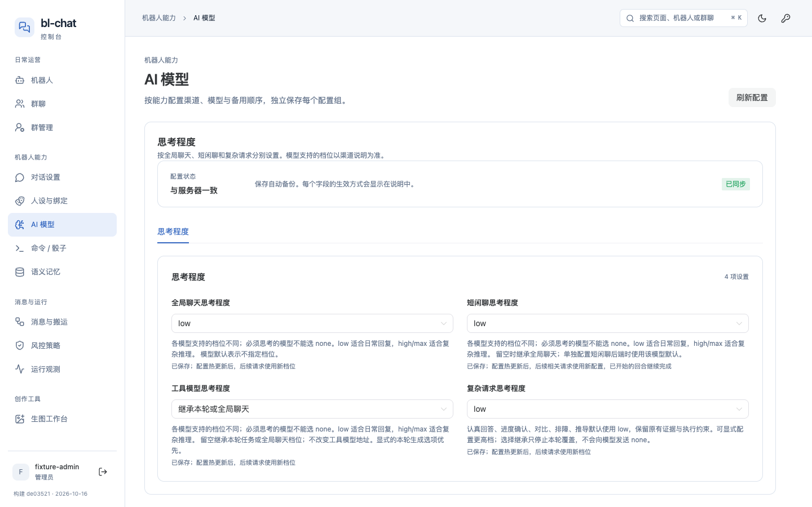
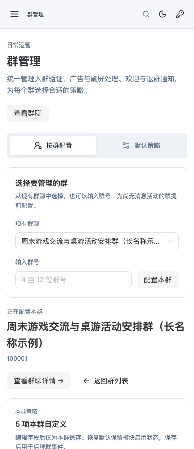
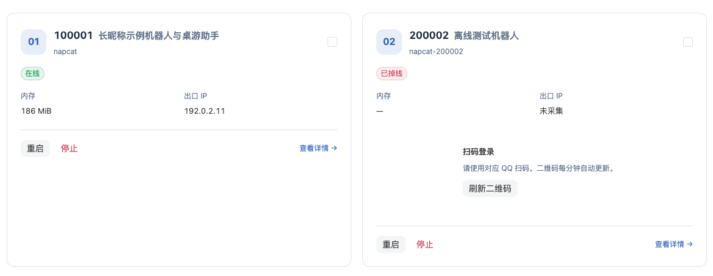
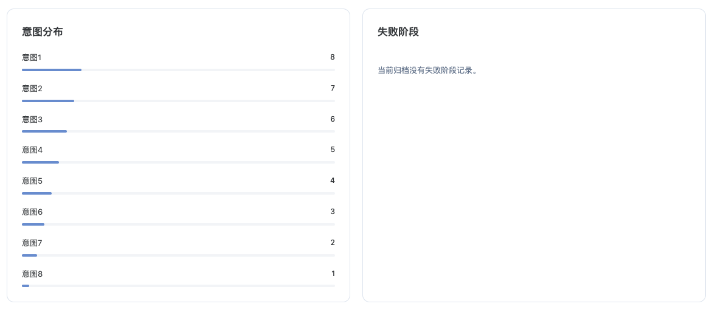
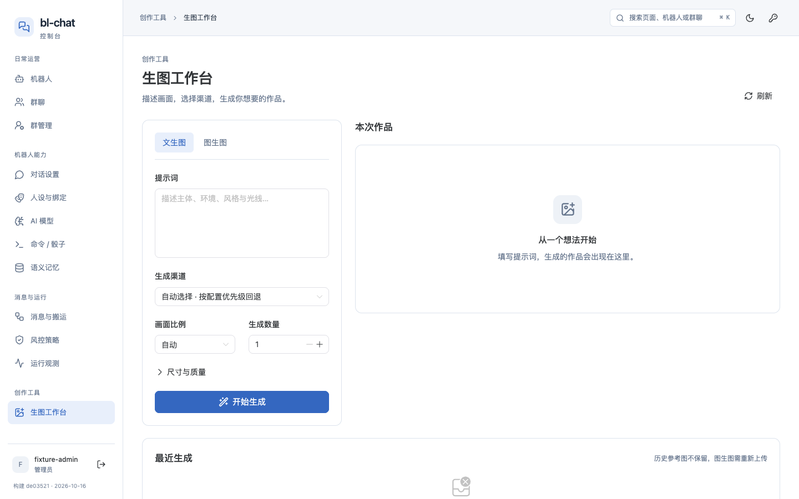
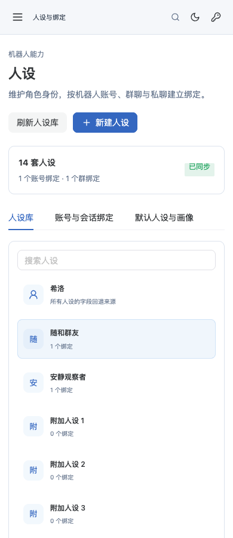
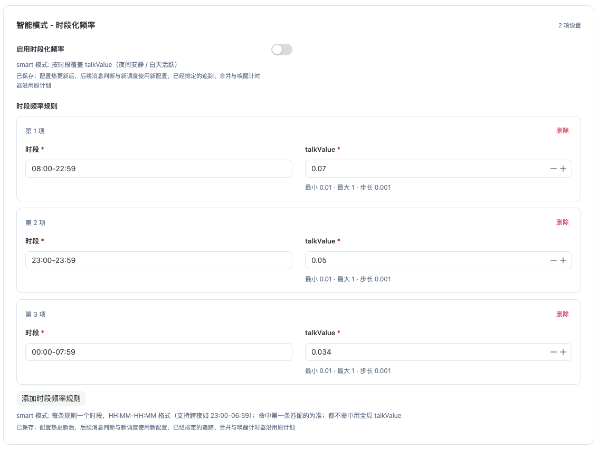

# 控制台留白与信息密度审查

日期：2026-10-16。范围：当前本地控制台的全部业务路由、主要任务分区与共享组件。

## 结论

低密度来自多处重复的布局结构：页头和说明层层堆叠、卡片默认等高、双列与跨列字段混排、列表默认进入完整编辑状态，以及手机端沿用桌面内容顺序。单独缩小全局间距，解决不了这些问题。

优先调整共享配置骨架、AI 模型、单群管理、账号/观测卡片、生图工作台和手机人设选择。命令编辑、骰子素材、宽屏容器和群表格随后统一。

本轮完成审查与建议，保留页面实现。新增内容为本报告、证据截图及审查记录。

## 覆盖与方法

- 14 个业务路由；群管理额外检查未选群、指定群、默认策略，合计 16 个入口状态。
- 1440、1920、1024、768、390、320px 六种宽度，主要视口高度为 900px；另检查 720px 高度的嵌入明细。
- 1440、390px 遍历主要分区和配置 tabs；其余宽度检查各路由入口。检查群详情与说说抽屉、登录与首次设置，并对关键页面复核深色主题。
- 共记录 256 个状态：228 个基础状态、23 个变体/认证/主题状态、5 个定点复核。数量表示渲染观察状态，不表示 256 项业务功能测试。
- 使用实际构建资源与本地 loopback fixture。构建时间为 2026-10-16 13:29:24（北京时间），晚于本轮开始前最后一次前端源码修改。数据使用示例账号、群、人设与默认配置，未连接运行实例。
- 结合源码、DOM 尺寸和截图判断。数据少造成的空白，只有与固定布局规则共同复现时才记为问题。

| 页面 | 检查内容 | 主要结果 |
| --- | --- | --- |
| 机器人 `/` | 正常/离线账号、扫码账号、筛选与统计 | 同行账号卡被二维码区撑高；统计和筛选也可压缩 |
| 机器人详情 `/bot/:qq` | 账号资料、人设绑定、今日统计、说说抽屉 | 右列内容短，后续空间利用偏低；已顶对齐，不是卡片拉伸 |
| 群聊 `/groups` | 长群名、机器人名称、群管状态、详情抽屉 | 固定表宽导致普通桌面也需横滚 |
| 群管理 `/group-admin` | 未选群、单群、默认策略；三个模块 | 单群页选择区和编辑头部堆叠；继承字段外框较重 |
| 人设 `/persona` | 人设库、绑定、默认人设与画像的七个分区；14 套人设变体 | 手机列表把编辑器推远；跨列字段和继承态占位明显 |
| AI `/ai` | 思考程度和十个能力分组 | 渠道配置整体被推到首屏之后 |
| 对话 `/conversation` | 五个配置分区、六个追踪分区、高级折叠 | 多层头部、长说明、双列空洞 |
| 消息与搬运 `/pipeline` | 可靠管道、平台授权、健康报告、任务记录 | 配置继承共享骨架问题；任务列表没有额外强制高空白 |
| 风控 `/risk` | 发送节奏、内容审查、风险响应 | 摘要层占首屏，开关与长说明同行出现空高 |
| 生图 `/draw` | 文生图、图生图、空结果、有历史作品 | 右侧空区与历史所在层级不合理 |
| 观测 `/observe` | 指标、活动图、分布、耗时、最近回合；八种意图且无失败 | “无失败”卡被意图卡撑高 |
| 明细 `/observe/details` | 900/720px 高度 | iframe 的 700px 下限覆盖可用高度 |
| 命令与骰子 `/commands` | 命令总表、骰子基础三个分区、回复、牌堆/规则、表情包 | 默认编辑长表单；短模板占全宽；素材区重复间距 |
| 记忆 `/semantic` | 四个运营工具、五个记忆策略分区 | 多层骨架；运行信息双列分配不匹配信息量 |
| 认证 | 登录、首次设置，桌面与手机 | 介绍区留白符合认证场景，未列为优先问题 |

加载骨架、错误提示、保存栏另外检查了组件源码；没有对所有路由逐一注入网络错误。

## 最能说明问题的测量

以下 Y 坐标从文档顶部计算，截图前已回到页顶。宽度对应 1440×900 或 390×900。字段坐标指字段标签/容器起点。

| 场景 | 1440px | 390px | 含义 |
| --- | --- | --- | --- |
| AI 首个渠道名称字段 | Y=1264 | Y=1757 | 首屏完整展示思考程度，主渠道编辑需要继续下翻 |
| 单群管理首个策略字段 | Y=996 | Y=1267 | 样例包含长群名及总开关提醒；首屏没有策略开关 |
| 对话配置首个字段 | Y=599 | Y=677 | 正式设置前已有多层导航、状态和说明 |
| 有二维码的账号同行卡 | 正常卡额外增加约 158px 空高 | 手机单列不发生同行撑高 | 是布局规则与状态差异共同造成 |
| 八种意图且无失败 | 无失败卡额外增加约 321px 空高 | 手机单列不发生同行撑高 | 健康状态反而显示大块空卡 |
| 14 套自定义人设 | 编辑器 Y=387 | 编辑器 Y=1581 | 手机先铺完整列表，再进入编辑 |
| 生图初始结果区 | 空引导卡高 304px，其下约 203px 仍需等待左栏结束 | 历史区 Y=1190（有历史变体） | 结果与历史未形成连续内容流 |

这些数值受字段说明、群名、提醒与样例数据影响；对应的结构和触发条件见下文。

## 优先处理

这里的 P1 表示本次密度调整优先级。

### P1-1 共享配置骨架占据过多首屏

**影响**：对话、追踪、风控、管道、默认群管、默认人设、骰子基础、记忆策略，以及嵌入 AI 的思考程度。

`SchemaPage` 常驻“配置状态”卡，再展示分区 tabs、分区提示、面板标题和字段；外层任务页还会增加任务 tabs。全局每层默认有 22px 间距。1440px 下，单张同步状态卡约 83px，连同前后间距占据了可观高度，却主要重复“已同步”和保存说明。

证据：[SchemaPage.vue:393](/Users/shiqi/IdeaProjects/bl-chat-plugin/console/frontend/src/pages/SchemaPage.vue:393)、[ConversationPage.vue:24](/Users/shiqi/IdeaProjects/bl-chat-plugin/console/frontend/src/pages/ConversationPage.vue:24)、[style.css:109](/Users/shiqi/IdeaProjects/bl-chat-plugin/console/frontend/src/style.css:109)。

**建议**：同步/草稿状态并入页头；每个页面保留一个明确主标题；内嵌编辑器取消重复的状态大卡；分区说明贴近标题，用简短文字表达。保存冲突、服务重装等会影响操作判断的提醒继续明确展示。

### P1-2 AI 页先展示完整思考表单，渠道入口过深

思考程度外面有一个大面板，里面嵌入完整 `SchemaPage`，再次出现状态、单项 tab、同名标题和四个字段。能力分组随后才开始。1440px 下，思考面板从 Y=216 到 878；能力 tabs 在 Y=1008，首个渠道卡从 Y=1191 开始。

证据：[AiPage.vue:352](/Users/shiqi/IdeaProjects/bl-chat-plugin/console/frontend/src/pages/AiPage.vue:352)。

**建议**：模型渠道作为默认主工作区；思考程度放入同级任务分区或紧凑折叠区，解除双层卡片和同名标题。能力切换、渠道状态与添加入口集中在同一工作区头部。

### P1-3 单群页重复展示选群、群标题、摘要和操作

选群后仍保留完整“选择要管理的群”面板。其后依次是群标题、策略摘要、条件提醒、模块 tabs，最后才是设置。1440px 的选群面板约 173px，策略摘要约 117px。手机上还会因描述和长群名折行继续增高。

另外，每个继承字段都展示继承工具栏、完整控件与帮助；自定义后又追加默认值预览。大量沿用默认值的字段也处于完整编辑布局。

证据：[GroupAdminPage.vue:147](/Users/shiqi/IdeaProjects/bl-chat-plugin/console/frontend/src/pages/GroupAdminPage.vue:147)、[GroupAdminEditor.vue:326](/Users/shiqi/IdeaProjects/bl-chat-plugin/console/frontend/src/components/GroupAdminEditor.vue:326)、[GroupAdminEditor.vue:425](/Users/shiqi/IdeaProjects/bl-chat-plugin/console/frontend/src/components/GroupAdminEditor.vue:425)。

**建议**：未选群时保留完整选择区；选群后改为一行搜索切换器，将群名、状态、刷新和详情入口合并。继承态使用“名称、当前值、继承标记、自定义”紧凑行，展开或自定义时显示完整编辑控件。总开关关闭等关键提醒保留。

### P1-4 账号与观测卡片默认等高，制造大块空卡

两个场景都已用数据变体复现：

- 同一行中，一个账号有二维码区、另一个没有，账号网格将两张卡都撑到约 418px。正常卡底部总空白约 181px，其中约 158px 来自额外伸展。
- 左侧展示八种意图、右侧无失败时，两张分布卡都高约 484px。右侧内容结束后约 346px 为空，其中约 321px 为同行伸展产生。

证据：[BotsPage.vue:541](/Users/shiqi/IdeaProjects/bl-chat-plugin/console/frontend/src/pages/BotsPage.vue:541)、[AccountCard.vue:98](/Users/shiqi/IdeaProjects/bl-chat-plugin/console/frontend/src/components/AccountCard.vue:98)、[ObservePage.vue:210](/Users/shiqi/IdeaProjects/bl-chat-plugin/console/frontend/src/pages/ObservePage.vue:210)、[ObservePage.vue:505](/Users/shiqi/IdeaProjects/bl-chat-plugin/console/frontend/src/pages/ObservePage.vue:505)。

**建议**：卡片按内容高度顶对齐；二维码按需展开或使用独立登录区；“无失败”压成紧凑健康状态。若还希望后续内容填补两列高度差，需要调整区块流向，单加顶对齐只能消除卡片内部的假高度。

### P1-5 生图结果与历史被分到不同层级

左侧全部控件、右侧本次作品同处一个 grid 行，“最近生成”则在整个 grid 之后。因此右侧内容较短时，也必须等左侧结束才出现历史。初始空结果卡还有上下各 90px 的 padding；手机虽然降为各 55px，仍排在完整控件之后。

证据：[DrawPage.vue:266](/Users/shiqi/IdeaProjects/bl-chat-plugin/console/frontend/src/pages/DrawPage.vue:266)、[DrawPage.vue:422](/Users/shiqi/IdeaProjects/bl-chat-plugin/console/frontend/src/pages/DrawPage.vue:422)、[DrawPage.vue:456](/Users/shiqi/IdeaProjects/bl-chat-plugin/console/frontend/src/pages/DrawPage.vue:456)、[DrawPage.vue:521](/Users/shiqi/IdeaProjects/bl-chat-plugin/console/frontend/src/pages/DrawPage.vue:521)。该 grid 已有 `align-items:start`，空区来自内容分组。

**建议**：桌面右侧连续排列本次结果与历史；初始引导收为紧凑提示，生成后由作品尺寸决定展示空间。手机先展示提示词、必要选项和生成按钮，再展示结果与历史，次要参数保持折叠。

### P1-6 手机人设列表随数量增长，把编辑器不断向后推

≤736px 时，左右栏变为上下排列，全部人设选项用可换行 flex 展示，列表没有收起状态。390px 下通常每行一个选项。14 套自定义人设加默认入口时，列表约 1163px 高，编辑器从 Y=1581 才开始。

证据：[PersonaPage.vue:1022](/Users/shiqi/IdeaProjects/bl-chat-plugin/console/frontend/src/pages/PersonaPage.vue:1022)。

**建议**：手机使用可搜索选择器或可收起的人设列表；选中后编辑区直接跟随选择器。桌面侧栏可保留列表，针对数量增长再设置合适的滚动范围。

## 后续统一优化

### P2-1 表单尺寸策略制造半行空洞和同行空高

通用表单固定两列，textarea、凭据和子表单一律跨整行。单数短字段后紧接跨列字段时，会留下右半行。已复现的例子：

- 对话追踪 → 参与频率 → 时段化频率：开关占左侧 523×87px，右半格为空，下一项子表单再占整行。
- 自定义人设：“固定边界”后接跨列“其他备注”；心情子表单中“心情名”后接跨列“心情提示”。

长短帮助文案同行时，下一行仍按较高字段的位置开始。参与频率中的“注意力漂移”字段实测底部空高约 100px。每个字段还重复展示生效说明和数值限制，长技术说明经常占据多行。

证据：[SchemaField.vue:89](/Users/shiqi/IdeaProjects/bl-chat-plugin/console/frontend/src/components/SchemaField.vue:89)、[style.css:163](/Users/shiqi/IdeaProjects/bl-chat-plugin/console/frontend/src/style.css:163)、[SchemaField.vue:210](/Users/shiqi/IdeaProjects/bl-chat-plugin/console/frontend/src/components/SchemaField.vue:210)、[schemaState.ts:196](/Users/shiqi/IdeaProjects/bl-chat-plugin/console/frontend/src/lib/schemaState.ts:196)。

**建议**：为开关、短数值、常规输入、长文、子表单定义内容尺寸；模块开关可放标题行。按语义组织字段，避免“单个半宽项 → 全宽项”的固定顺序。共同生效说明放到分区，仅有差异的字段单独说明；复杂帮助按需展开。仅调整 `align-items` 不能消除 grid 的空单元格和共享行高。

### P2-2 命令总表默认全量编辑，浏览成本高

每条命令默认展开用法、权限、说明、实现位置四个字段，外加序号和删除入口。样例中一条短命令在桌面占约 219px，手机约 376px；手机第一条命令到 Y=1189 才出现，前面是模块选择和模块编辑。

证据：[CommandsPage.vue:339](/Users/shiqi/IdeaProjects/bl-chat-plugin/console/frontend/src/pages/CommandsPage.vue:339)、[CommandsPage.vue:498](/Users/shiqi/IdeaProjects/bl-chat-plugin/console/frontend/src/pages/CommandsPage.vue:498)。

**建议**：默认以紧凑摘要行显示命令、说明和权限，选中后展开编辑；模块元信息放折叠区。保留现有草稿和保存语义，避免切换展示方式时丢失编辑。

### P2-3 骰子短回复占全宽，素材区间距重复叠加

短回复模板也统一使用至少两行的全宽 textarea，且每项额外有 16px 上间距。牌堆/规则区域同时使用父级 22px gap 与规则区 30px margin，实测区块间隔 52px。空数据时空网格仍参与父级间距计算。

证据：[DiceSettings.vue:175](/Users/shiqi/IdeaProjects/bl-chat-plugin/console/frontend/src/components/DiceSettings.vue:175)、[DiceSettings.vue:306](/Users/shiqi/IdeaProjects/bl-chat-plugin/console/frontend/src/components/DiceSettings.vue:306)、[DiceAssets.vue:477](/Users/shiqi/IdeaProjects/bl-chat-plugin/console/frontend/src/components/DiceAssets.vue:477)、[DiceAssets.vue:680](/Users/shiqi/IdeaProjects/bl-chat-plugin/console/frontend/src/components/DiceAssets.vue:680)。

**建议**：短回复采用紧凑字段，长回复可展开；桌面可按回复类别组织双列。素材分区统一使用一个间距来源；无条目时不输出空网格，把引导与导入入口放在一起。

### P2-4 宽屏容器叠加限宽，页面宽度不一致

外层工作区最大 1390px，内部还分别限制配置/AI/对话为 1120px、人设/群管为 1180px。1920px 下，工作区扣除 padding 后有 1322px 可用，1120px 页右边仍剩约 202px；内层未居中，形成不对称空区。宽屏没有增加更多有效配置内容。

证据：[style.css:398](/Users/shiqi/IdeaProjects/bl-chat-plugin/console/frontend/src/style.css:398)、[SchemaPage.vue:463](/Users/shiqi/IdeaProjects/bl-chat-plugin/console/frontend/src/pages/SchemaPage.vue:463)、[AiPage.vue:595](/Users/shiqi/IdeaProjects/bl-chat-plugin/console/frontend/src/pages/AiPage.vue:595)、[ConversationPage.vue:64](/Users/shiqi/IdeaProjects/bl-chat-plugin/console/frontend/src/pages/ConversationPage.vue:64)。

**建议**：统一列表/数据页、设置页、创作页的宽度规则。运营数据利用工作区；短数值密集分区在足够宽时可使用三列；长文本维持可读宽度。容器限宽若要保留，应明确对齐或居中方式。

### P2-5 群表格固定 1215px，普通桌面也需要横滚

1440px 下实际表格宽 1215px，而容器只有 1100px，横向溢出 115px；页面文档本身没有溢出，所以前序页面溢出检查无法发现末列需要横滚。手机容器只有约 324px，查看完整一行需要较多横移。

证据：[GroupsPage.vue:63](/Users/shiqi/IdeaProjects/bl-chat-plugin/console/frontend/src/pages/GroupsPage.vue:63)、[GroupsPage.vue:247](/Users/shiqi/IdeaProjects/bl-chat-plugin/console/frontend/src/pages/GroupsPage.vue:247)。

**建议**：重分群身份、状态、统计和操作的列宽；群号与群名纵排，短状态使用紧凑列，次要操作收起。手机提供群摘要列表与详情入口，保留真正需要横向比较的数据表场景。

### P2-6 记忆运行信息的五块内容机械双列

索引配置、向量模型、重排模型、检索器、索引器统一两列排布。字段数差异较大，未启用的重排模块也占一个完整位置，最后一行只有半宽内容。数据量增大时，短块会等待长块的行高。

证据：[SemanticPage.vue:414](/Users/shiqi/IdeaProjects/bl-chat-plugin/console/frontend/src/pages/SemanticPage.vue:414)。

**建议**：未启用模块使用状态行，常用指标合并成摘要，详细配置按需展开；根据内容量分配列宽和所在分区。

### P2-7 嵌入明细的最小高度覆盖视口适配

iframe 同时设置 `height:calc(100vh - 230px)` 与 `min-height:700px`。1440×720 下仍为 700px，起点 Y=189、底部 Y=889，外层需要滚动。明细内部若有长内容，还需单独验证内外滚动关系；当前 fixture 不能证明真实明细内部的表现。

证据：[EmbeddedPage.vue:40](/Users/shiqi/IdeaProjects/bl-chat-plugin/console/frontend/src/pages/EmbeddedPage.vue:40)。

**建议**：按实际剩余视口高度控制 iframe，统一内外滚动策略；保留现有“新窗口打开”入口。

## 应保留的空间与低优先项

- 图片预览比例、二维码可扫描尺寸、说说创作文本区、长提示词和人设长文编辑区都有明确用途；通过展开与内容尺寸调整，不机械缩小。
- 表情包的图片容器和 `object-fit:contain` 需要保留预览空间。45 条示例素材下没有发现上述卡片撑高级别的异常，先统一标题、筛选和区块间距即可。
- 首次使用的空态应提供下一步操作；加载骨架的临时高度与稳定页面的空白分开评价。
- 保存栏在没有草稿、保存过程或成功提示时不渲染，没有固定空栏占位（[SaveBar.vue:8](/Users/shiqi/IdeaProjects/bl-chat-plugin/console/frontend/src/components/SaveBar.vue:8)）。
- 人设左右栏、机器人详情已经使用顶对齐。机器人详情右列仅有今日统计时仍偏空，可将统计并入紧凑摘要，再安排详情内容；不要为了齐底再加固定高度。
- 登录页的介绍区与认证卡具有单一任务，可保留较宽松的布局。

## 建议实施顺序与验收口径

| 顺序 | 工作 | 验收重点 |
| --- | --- | --- |
| 1 | 共享页头/状态/说明骨架，表单尺寸与帮助层级 | 基础字段不被重复说明挤出首屏；开关、数值与长文各有合适宽度；同步和冲突状态清晰 |
| 2 | AI、单群管理、手机人设、生图内容分组 | 900px 高视口中看到对应核心编辑或操作；选群后不重复展示大选择卡；14 套人设不推走编辑器；历史紧随结果流 |
| 3 | 账号、观测、命令、素材、群表格 | QR/健康状态不撑空同行卡；命令可快速扫描；单一分区间距；普通桌面能看到主要群操作 |
| 4 | 宽屏容器、运行信息、嵌入明细的一致性 | 320/390/768/1024/1440/1920px 复核，低高度视口可用；长文和图像仍可读 |

可以先以以下目标约束实现，再结合实际截图调整：桌面常用字段间距 12–16px、面板内边距 16–20px、主分区间距 16–20px；短控件维持清晰可操作的尺寸。数值是设计建议，本轮没有修改这些样式。

首屏目标应按任务判断：AI 看到能力切换及首个渠道；单群管理看到所选群及策略开关；手机人设看到当前选择及编辑器；生图看到核心输入与生成操作。高风险提示允许占用额外高度。保持键盘顺序、草稿保护、保存冲突处理和移动触控能力。

## 证据与验证边界

- 基础几何与截图：[geometry.json](/tmp/bl-console-density-audit-20261016/browser/geometry.json)。
- 数据/认证/深色变体：[geometry.json](/tmp/bl-console-density-audit-20261016/variants/geometry.json)。
- 卡片、真实表宽、首次空素材、低高度明细复核：[geometry.json](/tmp/bl-console-density-audit-20261016/targeted/geometry.json)。
- 临时审查脚本与完整截图在 `/tmp/bl-console-density-audit-20261016/`；本报告旁保留 7 张关键截图，便于后续实现对照。
- 228 个基础状态与 23 个变体记录中，浏览器错误、缺失 API、外部请求均为空；5 个定点复核无脚本失败、缺失 API 或外部请求。这里验证的是本地页面布局，实际实例数据仍需在调整实现后验收。
- 没有为审查新增产品测试或修改业务代码；本轮交付为审查报告。
